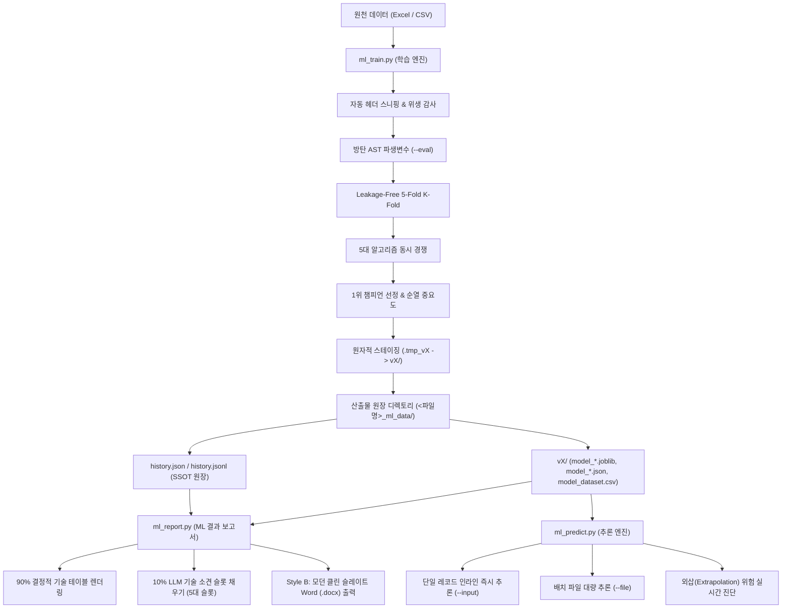
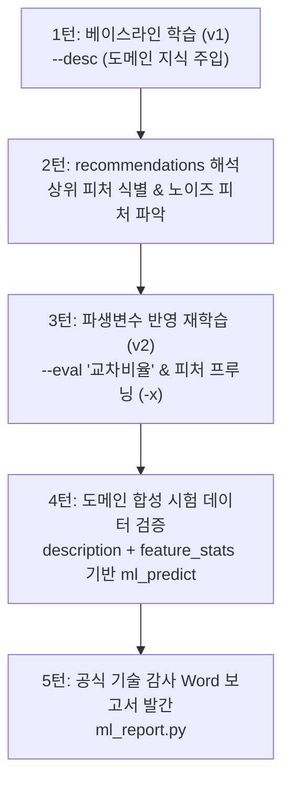

# ml-kit: 경량 AI 에이전트를 위한 자율 회귀·분류 머신러닝 툴킷 (Autonomous Regression / Classification ML Toolkit)

> **26B~30B 경량화 LLM(Glimmer-30B, OpenCode 등)에 최적화된 1-Turn 완결형 머신러닝 학습, 추론 및 기술 감사 엔진**  
> 복잡한 다단계 판단이나 인간의 개입 없이, 단 1회의 선언적 CLI 명령으로 데이터 자동 정제, 방탄 파생변수 생성, 5대 회귀/분류 모델 경쟁 학습, 단일 진실 공급원(SSOT) 원장 누적, 초고속 서빙 추론, 그리고 Word(.docx) ML 결과 보고서 생성을 100% 자율 완결합니다.

---

## 1. 핵심 아키텍처 원칙 (Core Architectural Principles)

1. **완전 독립 자립형 (100% Standalone & Zero-Office COM)**:
   - 외부 프레임워크나 무거운 분산 엔진, MS Office COM(Component Object Model) 의존성을 일체 배제합니다.
   - 순수 `Python + Scikit-Learn + Pandas + NumPy + Joblib + python-docx`만으로 작동하여 가상 데스크톱, Linux/Windows 서버, CI/CD 컨테이너 환경에서 0.1초대의 초고속 백그라운드 무인 실행을 보장합니다.

2. **26B~30B 경량화 LLM 최적화 (1-Turn Declarative Execution & Zero-Token Bloat)**:
   - 추론 능력이 제한된 온프레미스 경량 LLM이 복잡한 루프를 돌지 않도록, 단 1회의 CLI 명령 호출로 모든 워크플로우를 완결합니다.
   - 표준 1줄 구조화 JSON(`{"status": "ok", "agent_directive": "VERIFIED: ...", ...}`)을 반환하여 에이전트의 불필요한 재시도 및 토큰 낭비를 원천 차단합니다.

3. **단일 진실 공급원 (Single Source of Truth, SSOT)**:
   - 모든 실험 이력은 `history.jsonl`(스트리밍 라인)과 `history.json`(포맷 배열)으로 이중 동기화 보존됩니다.
   - 추가적인 데이터 조회 없이 이 원장 단 하나만으로 차수별 계보(Lineage Evolution), 2차원 변수 상관행렬, 5대 모델 벤치마크, 순열 중요도, 외삽 경계선, 데이터 품질 감사를 100% 완전 재현합니다.

4. **원자적 트랜잭션 보장 (Atomic Staging & Self-Healing Garbage Collection)**:
   - 학습 도중 예기치 못한 중단(`Ctrl+C`, 프로세스 킬, 메모리 부족) 발생 시 미완성 잔여물이 운영 환경을 오염시키지 않도록 임시 디렉토리(`.tmp_vX/`)에서 모든 작업을 수행합니다.
   - 모든 검증과 아티팩트 저장이 100% 완료된 순간에만 원자적 이름 변경(`vX/`)을 수행하고, **그 다음에** 원장에 기록합니다 (커밋이 실패하면 원장에 없는 버전이 남지 않음). 프로세스 기동 시 도구가 만든 `.tmp_*` 잔여물만 자가 청소(GC)합니다.
   - **사용자 확인 없이 지우거나 덮어쓰지 않습니다**: 불완전한 `vN` 폴더는 지우지 않고 `[WARN]`과 `incomplete_versions`로 알린 뒤 그 번호를 건너뜁니다. 이미 있는 `--version`은 `--overwrite` 없이는 거부합니다.
     예측 결과·보고서 파일이 이미 있으면 시각을 붙인 새 이름으로 저장하고 JSON `recovered`에 적습니다 (덮어쓰기는 `--overwrite`).

5. **터미널 및 인코딩 무결성 (Clean Terminal Principle & UTF-8 BOM CSV)**:
   - Windows 콘솔의 폰트 폭 계산 오차, 줄바꿈 꼬임, 로그 오염, 인코딩 에러(`UnicodeEncodeError`)를 유발하는 유니코드 이모지(아이콘, 원문자 등)의 사용을 엄격히 금지하고 표준 텍스트 태그(`[INFO]`, `[PROGRESS]`, `[WARN]`, `[ERROR]`, `[STATUS]`)만을 사용합니다.
     진행 줄은 `[PROGRESS] 45% <내용>` 한 줄씩(줄 덮어쓰기 `\r`과 막대 `[===---]` 없음), `--history` 표의 머리는 `[STATUS]`.
   - 도구가 쓰는 CSV(예측 결과, `excluded_rows.csv`, `model_dataset.csv`)는 모두 BOM이 붙은 UTF-8(`utf-8-sig`)입니다. 한국어 Windows Excel이 더블클릭으로 바로 열고, 에이전트의 파일 읽기 도구가 다른 인코딩으로 오인하지 않습니다 (CP949 CSV를 깨진 글자로 읽은 에이전트가 제외 이유를 지어낸 사례). 도구가 읽을 때는 인코딩을 자동 판별합니다.

---

## 2. 시스템 디렉토리 구조 및 역할

### 1) 코드베이스 디렉토리 구조
```text
CLI/ml-kit/                 # 실행에 필요한 파일만 (사내 PC C:\CLI\ml-kit)
├── skills/<이름>/SKILL.md  # 경량 LLM 에이전트용 스킬 4개 (ml-train, ml-predict, ml-report, ml-map)
│
├── [1단계: 학습 엔진]
│   └── ml_train.py         # 자동 헤더 스니핑, 방탄 AST 파생변수, 5대 회귀/분류 경쟁, 리더보드, SSOT 패키징
│
├── [공통 런타임]
│   └── _ml_runtime.py      # 진입점 아님. 데이터 로딩, 수치 변환, 수식 엔진, JSON 규약, Windows 파일 처리,
│                           # 버전 고르기(-m <데이터 파일>), -i 해석 (모든 진입점이 import)
│
├── [2단계: 추론 엔진]
│   └── ml_predict.py       # _ml_runtime.py와 함께 단독 배포 가능. 파생 수식 재현, 외삽/저확신 경고, 회귀·분류 자동 분기
│
├── [3단계: ML 결과 보고서]
│   └── ml_report.py        # 버전 폴더 1개 -> Word 문서 1개 (회귀·분류, 차트 포함, 소견 자동 작성)
│
├── [표 보간·반대 찾기]
│   └── ml_map.py           # 모델 없이 표 선형 보간 (격자/흩어진 기록 자동 판단), 반대 찾기
│
└── [성능예측표]
    └── ml_export.py        # 입력 최적화 -> 엑셀 계산기 (수식만, 잠금)

data/logs/errors.txt        # 실패한 실행의 오류 로그 (자동 생성, git 제외, 8장 4) 참고)

CLI-dev/ml-kit/             # 개발·실기 테스트용 (사내 PC C:\CLI-dev\ml-kit, C:\CLI와 나란히)
├── README.md               # [본 문서] 툴킷 종합 안내서, 완전 CLI 레퍼런스
├── CHANGELOG.md            # 변경 이력 + 남은 할 일
├── requirements.txt        # 런타임 의존성
├── tests/                  # CLI 계약 + 회귀 테스트 (도구는 ../../CLI/ml-kit에서 불러옴), 기능별 파일:
│                           #   contract(1줄 JSON·exit·오류 로그), safety(덮어쓰기 금지·러너), train, predict,
│                           #   names(열 이름·단위·[후보]), map, report_export, loading_layout/totals/numbers(데이터 읽기),
│                           #   layout_matrix(머리글·단위 행 매트릭스), skill_docs. 공용: mlkit_helpers.py, conftest.py
└── tools/run_win_tests.py  # Windows 실기 테스트 (실제 Excel/Word, 파일 잠금, cmd/PowerShell, 배포 폴더)
                            #   --dir은 없는 경로나 빈 폴더 (러너가 만든 폴더만 다시 비움)
                            #   결과: 테스트 폴더 report_*.txt(요약) + tools/test_logs/testlog_<라벨>_<시각>.txt(AI 판독용 상세 로그)
```

### 1-B) OpenCode 스킬 설치

도구는 `C:\CLI\ml-kit`에 둡니다. 스킬(`skills/<이름>/SKILL.md`)의 명령 경로가 이 위치 기준으로 적혀 있습니다 (사내 PC 배치 안내: `docs/opencode/README.md`).
OpenCode는 `skills/<name>/SKILL.md` 를 찾으며 **폴더 이름이 스킬 이름과 같아야** 합니다. ml-kit 스킬은 작업별 4개입니다 (2.9.71): `ml-train`(학습·개선·이력), `ml-predict`(예측·반대 찾기·조건별·최적 조건), `ml-report`(보고서·성능예측표), `ml-map`(모델 없이 표 보간).

1. `C:\CLI\setup.bat`이 `C:\CLI\ml-kit\skills\<이름>\SKILL.md` 4개를 `%USERPROFILE%\.config\opencode\skills\<이름>\`로 복사하고 옛 `skills\ml-kit\`을 지웁니다.
2. 도구를 다른 위치에 두면 스킬 4개 안의 `C:\CLI\ml-kit`을 그 경로로 모두 바꿉니다.
3. 권한을 제한하는 경우 `opencode.json` 에 `"permission": {"skill": {"ml-train": "allow", "ml-predict": "allow", "ml-report": "allow", "ml-map": "allow"}}` 를 추가합니다.
4. OpenCode에서 에이전트가 `skill({ name: "ml-kit" })` 로 스킬을 불러오는지 확인합니다.

### 2) 런타임 산출물 원장 계층 구조 (`<데이터파일명>_ml_data/`)
학습 엔진 실행 시 입력 데이터셋 파일과 동일한 디렉토리에 `<파일명>_ml_data/` 폴더가 자동 생성되며 모든 산출물이 원자적으로 격리 관리됩니다:

```text
<데이터파일명>_ml_data/
├── history.jsonl              # [SSOT 스트리밍] 회차별 실험 메타데이터 누적 원장 (JSON Lines)
├── history.json               # [SSOT 표준배열] 가독성 및 LLM 일괄 조회를 위한 동기화 원장 (JSON Array)
├── ML결과보고서_<데이터>_vX.docx # [ML 결과 보고서] ml_report.py 기본 저장 위치
├── 성능예측표_<데이터>_vX.xlsx   # [성능예측표] 회귀 보고서와 함께 생성 (ml_export.py)
├── .train.lock                # [동시 실행 잠금] 학습 중에만 OS 잠금 (비정상 종료 시 자동 해제)
├── .tmp_vX/                   # [임시 트랜잭션] 원자적 스테이징 폴더 (작업 성공 시 vX로 치환, 실패 시 자동 GC)
└── vX/                        # [버전 체크포인트 디렉토리] (v1, v2, v3, ...)
    ├── model_<타겟>.joblib     # 1위 챔피언 파이프라인 (전처리[수치 대치+스케일, 범주 원-핫] + 모델 일체형)
    ├── model_<타겟>.json       # 타겟별 추론 메타데이터 (feature_schema, 지표, 외삽 경계, 예측 범위, 판정 기준, 파생 수식)
    ├── leaderboard.json       # 5대 알고리즘 교차검증 대조표 (튜닝된 params 포함)
    ├── correlation.csv        # 전체 상관행렬 (원장에는 피처 30개 이하로 축약 저장)
    ├── oof_<타겟>.csv          # 챔피언의 교차검증 예측값 (실측·예측·잔차 또는 클래스별 확률, 보고서 그림 원본)
    ├── next_features_*.txt    # next_commands용 피처 목록 (피처 15개 초과이거나 이름에 큰따옴표가 있을 때. 타겟은 next_targets.txt)
    ├── excluded_rows.csv      # 학습에서 뺀 행 (원본 행, 구분, 이유, 실제값, 예측값)
    ├── export/                # 성능예측표용으로 다시 학습한 모델과 후보 표. _fits/: 후보 학습 저장 (나눠서 진행)
    └── model_dataset.csv      # 학습 당시 헤더 정제, 결측치 대치, 파생변수가 완료된 스냅샷 (UTF-8 BOM)
```

---

## 3. 전체 엔드투엔드 파이프라인 흐름 (System Pipeline Architecture)



---

## 4. 학습 엔진 (`ml_train.py`) 상세 가이드

단 1회의 명령으로 [데이터 로드 -> 비표준 헤더 스니핑 -> 결측치 대치 -> 방탄 파생변수 -> 5대 모델 5-Fold 경쟁 -> 리더보드 -> 챔피언 가중치 패키징 -> SSOT 원장 갱신]을 완전 무인으로 완결합니다.

### 0) 스레드 (2.9.79)
표가 2만 행(`MANY_THREADS_ROWS`)보다 작으면 학습·예측은 한 스레드로 합니다 (HistGradientBoosting의 OpenMP와 BLAS는 `threadpoolctl`,
RandomForest·ExtraTrees는 `n_jobs=1`). 작은 표에서는 한 스레드가 더 빠르고, 다른 프로그램이 CPU를 쓸 때 여러 스레드가 서로 기다려
학습이 수십 배 느려지는 일을 막습니다. 결과는 스레드 수와 상관없이 같습니다 (`random_state` 고정).

### 0-A) 입력 자동 선택 (`-x` 생략, 2.9.72)
`-x`를 빼면 도구가 타겟(`-y`)을 뺀 모든 열에서 입력을 고르고, 뺀 열마다 이유를 적습니다 (`diagnose_inputs`, `auto_inputs`).
날짜 열과 종류가 적은 글자 열(라인, 설비)은 입력으로 남습니다. 규칙(위에서부터 처음 맞는 것):

| 뺀 이유 (`INPUT_KIND_LABEL`) | 기준 |
|---|---|
| 제외 표시 열 | 학습에서 뺄 행을 표시하는 `제외` 열 |
| 빈 칸 많음 | 빈 칸(빈 값, `-`, `N/A` 같은 자리표시)이 행의 50% 초과 (`AUTO_MISSING_SHARE`) |
| 상수 | 값이 하나뿐 |
| 타겟 누수 | 회귀: 숫자 타겟과 상관계수 절댓값 0.98 이상(`AUTO_LEAK_CORR`, 다른 단위·배율·타겟에서 계산한 값), 타겟과 이름이 같고 단위만 다르면 0.9 이상. 분류: 값이 타겟 종류와 1:1로 맞음. 두 값이 다 있는 행 8개 이상에서만 판단 |
| ID·일련번호 | 채운 칸이 5개 이상이고 모두 다르며, 1씩 늘어나는 정수(빈 번호가 있어도 범위가 행 수의 1.5배 이하), 공백 없는 숫자 포함 코드(`S-001`), 또는 이름이 `번호`·`순번`·`일련`·`로트`·`ID`·`No`·`Lot`·`Serial`. 모두 다른 실측 소수(175.3, 182.1)와 날짜는 입력 |
| 글자 종류 많음 | 글자 열의 종류가 10개 이상이고 채운 칸의 절반 초과 (비고·메모), 또는 200개 초과 |

- 결과 JSON: `features_auto`(고른 입력, 50개까지)와 `features_auto_count`, `features_auto_file`(`vX/features_auto.txt`, 한 줄에 하나: 그대로 `-x` 파일로 쓸 수 있음),
  `excluded_inputs`(`column`, `reason`, 50개까지)와 `excluded_inputs_count`. preview에 `입력 자동 선택 N개, 뺀 열 M개: 시료번호(ID·일련번호), ...`.
  원장에는 `features_used`(고른 입력)와 `input_selection`(`auto`, `features`, `excluded`). `--best`·`ml_report -f`는 이 `features_used`로 다시 학습합니다.
- 다시 학습하는 `next_commands`(저기여 피처 제외, 교차항)는 고른 입력을 `-x`로 적습니다 (15개를 넘으면 `next_features_*.txt` 파일 경로). 같은 데이터면 `-x` 없이 다시 실행해도 같은 입력을 고릅니다.
- 쓸 열이 하나도 없으면 `STOP_RETRY`(`excluded_inputs` 포함, `-x`로 입력을 주라는 안내).
- `-x`를 주면 그대로 학습하고, 준 입력 가운데 ID·타겟 누수로 보이는 열은 `warnings`와 `suspect_inputs`(`column`, `reason`), preview `의심 입력: ...`로만 알립니다 (빼지 않음).
- `--dtypes`로 형식을 정한 열은 그 형식으로 판단하고, 글자(`:str`)로 정한 열은 `글자 종류 많음`·코드 ID로 빼지 않습니다.

### 0) 피처 유형 자동 판별
`-x`에 넣은 컬럼(또는 자동으로 고른 입력)마다 도구가 유형을 정합니다. 판별 결과는 결과 JSON `feature_types`에 나옵니다.

| 유형 | 판별 기준 | 모델 입력 |
|---|---|---|
| 수치 | 값의 90% 이상이 숫자 (`1,234` 허용) | 중앙값 대치 + 표준화 |
| 날짜 | Excel 날짜 셀, 또는 90% 이상이 `YYYY-MM-DD[ HH:MM]` (`/` `.` 구분 허용) | `<컬럼>_year/month/day/dayofweek/hour` (값이 변하는 것만) |
| 범주 | 그 외 문자 컬럼 | 결측은 `__missing__`, 원-핫 인코딩 (처음 보는 값은 무시 + 예측 시 경고) |

- 종류가 200개를 넘거나, 50개를 넘으면서 행의 절반 이상이 서로 다른 문자 컬럼은 ID로 보고 `STOP_RETRY`.
- `--dtypes "설비코드:str,측정일:datetime,값:float"`로 유형을 강제할 수 있습니다. `:datetime`은 `YYYYMMDD` 8자리(숫자 또는 글자, 예: `20240103`)도 읽습니다.
  학습과 예측은 `_ml_runtime.py`의 같은 날짜 해석(`parse_datetime`)을 써서 결과가 같습니다.
- 날짜 분해는 파이프라인 밖(`_ml_runtime.py`)에서 하므로 모델 파일에 사용자 코드가 저장되지 않고, 예측 단독 배포(`ml_predict.py` + `_ml_runtime.py`)가 유지됩니다.

### 1) 5대 다중 회귀 모델 경쟁 풀 (Champion Selection)
수학적 성격이 완전히 상이한 5대 핵심 알고리즘을 누수 방지 파이프라인(`Pipeline(ColumnTransformer[수치: SimpleImputer(median) -> StandardScaler(), 범주: OneHotEncoder] -> Regressor)`)에 탑재하여 동시 5-Fold 교차검증을 수행하고, 검증 결정계수($Val\ R^2$) 최상위 1개 모델을 타겟별 공식 챔피언으로 선정합니다:

1. **HistGradientBoostingRegressor**: 비선형 복합 관계, 대용량 데이터, 결측치 및 이상치에 강건한 고성능 히스토그램 기반 GBDT.
2. **RandomForestRegressor**: 다수의 결정 트리를 배깅(Bagging)하여 과적합을 방지하고 분산을 최소화하는 전통적 앙상블.
3. **ExtraTreesRegressor**: 분할 지점을 극단적으로 무작위화하여 노이즈가 많은 연속형 공정 데이터에서 최상의 일반화 성능을 발휘하는 앙상블.
4. **Ridge** (`RidgeCV`): L2 정규화 선형 베이스라인. 정규화 강도 alpha를 1e-3~1e3 범위에서 자동 선택.
5. **ElasticNet** (`ElasticNetCV`): L1+L2 결합 희소 선형 모델. alpha와 l1_ratio(0.1/0.5/0.9)를 내부 3-Fold로 자동 선택.

선택된 값은 `leaderboard.json`의 `params`에 기록됩니다. 대용량 데이터(1만 행 초과)에서는 RF/ET 트리마다 1만 행 표본을 사용하고, 순열 중요도는 최대 5,000행 표본으로 계산합니다.

- **예측 범위**: 챔피언 모델의 교차검증 잔차(OOF residual) 5%·95% 분위수를 저장하고, 예측 시 `pred_lo_<타겟>`, `pred_hi_<타겟>`(90% 범위)를 함께 출력합니다. 폭이 일정한 근사 범위입니다.
- **중복 행**: 입력과 타겟이 완전히 같은 행이 있으면 같은 행끼리 묶어 같은 fold에 넣습니다(회귀 `GroupKFold`, 분류 `StratifiedGroupKFold`).
  복사본이 학습 fold에 있으면 검증 점수가 부풀기 때문입니다 (무작위 30행 x 4번 복사가 R² 1.0). 결과 `warnings`에 중복 개수를 알립니다. 중복이 없으면 fold 나누기는 바뀌지 않습니다.
  Word 보고서 "2. 데이터와 피처"에도 타겟별 중복 행 수를 씁니다.
  - 회귀: 입력+타겟이 서로 다른 행이 10개 미만이면 `STOP_RETRY` "입력+타겟이 다른 행이 N개뿐".
    학습 fold가 작으면 ElasticNetCV의 내부 교차검증 수를 줄입니다.
  - 분류: 어떤 클래스의 행이 모두 같아(서로 다른 행 1개) 묶을 수 없거나, 묶은 결과 어떤 학습 fold에 빠지는 클래스가 있으면
    그 타겟만 일반 `StratifiedKFold`로 검증하고 `warnings`에 이유를 씁니다.
    학습 fold가 5행보다 작으면 KNN 이웃 수를 그 행 수로 줄입니다.
- **작은 데이터**: 입력 검사(행 10개 이상, 클래스마다 2행 이상, 서로 다른 행 10개 이상)를 통과한 데이터는 내부 오류 없이 학습합니다.
  모델마다 학습 fold(와 마지막 전체 적합)의 크기에 맞춰 설정을 줄입니다 (`fit_safe_model`): KNN 이웃 수는 행 수 이하,
  ElasticNetCV 내부 교차검증은 fold당 2행 이상, LogisticRegressionCV 내부 층화 교차검증은 가장 작은 클래스 행 수가 3보다 적으면 2겹, 1행이면 C 기본값의
  일반 LogisticRegression. 학습 fold에서 값이 모두 빈 열은 0으로 채웁니다(`keep_empty_features`). 그래서 클래스 3개 이상 10~15행 분류도
  "n_splits=3 cannot be greater than the number of members in each class" 같은 내부 오류가 나지 않습니다. 데이터가 크면 설정은 그대로입니다.
- **값이 하나뿐인 타겟**: 회귀 타겟 값이 모두 같으면 `STOP_RETRY` ("값이 모두 같아(5.0) 학습할 수 없습니다"). R² 1.0과 `goal_met`이 나오지 않게.

### 1-B) 분류 모드 (`--task classification`)
작업 유형은 사용자가 `--task`로 지정합니다 (기본값 `regression`, 자동 판별 없음). 분류 모드는 같은 누수 방지 파이프라인(`SimpleImputer(median) -> StandardScaler() -> Classifier`)으로 **Stratified K-Fold** 교차검증을 수행하고, **OOF Macro-F1** 최상위 모델을 챔피언으로 선정합니다.

1. **HistGradientBoostingClassifier** 2. **RandomForestClassifier** 3. **ExtraTreesClassifier** 4. **LogisticRegression** (`LogisticRegressionCV`, C 자동 선택) 5. **KNeighborsClassifier** (5만 행 초과 시 제외)

- **이진 분류 판정 기준 (`--positive-class <라벨>`)**: 양성 클래스(예: 불량)를 지정하면 챔피언의 교차검증 확률로 양성 F1이 최대가 되는 기준 확률(0.05~0.95)을 찾아 `decision_threshold`로 저장하고, 예측 시 그 기준으로 라벨을 정합니다. 지정하지 않으면 기본(최대 확률) 판정입니다. 클래스에 없는 라벨이면 `STOP_RETRY` + `[후보] 불량, 양품`.

- **지표**: Macro-F1(선정 기준), Accuracy, Balanced Accuracy, ROC-AUC(이진/다중 ovr), 혼동행렬, 클래스별 Precision·Recall·F1 (`vX/leaderboard.json`)
- **라벨 정규화**: `1`, `1.0`, `"1"`은 같은 클래스 `"1"`로, 공백·`-`·`N/A`는 결측으로 처리하며 결측 라벨 행은 학습에서 제외
- **불균형 대응**: 최소 클래스 비율이 20% 미만이면 `class_weight='balanced'` 자동 적용 (`[WARN]` 출력, 처방에 기록)
- **검증**: 클래스 2개 미만, 샘플 1개짜리 클래스, 클래스 50개 초과는 `STOP_RETRY`. fold 수는 최소 클래스 샘플 수에 맞춰 자동 축소
- **이력 비교**: `delta_score`, `is_best`는 같은 task + 같은 타겟 조합의 이전 기록끼리만 비교 (같은 원장에 다른 타겟·회귀/분류 기록 공존 가능)
- **보고서**: `ml_report.py`가 분류 버전도 같은 구성으로 작성 (혼동행렬, 클래스별 성능 표)

```bash
python ml_train.py -f "공정.xlsx" -x "반응온도,촉매비율,수분함량" -y "품질등급" --task classification --tag "분류_베이스라인"
```

### 2) 방탄 AST 파생변수 엔진 (`--eval`)
파이썬의 위험한 `eval()` 함수를 일체 배제하고, `ast.parse`를 통한 화이트리스트 수학 연산자 구문 분석기(AST Evaluator)를 내장하였습니다:
- **지원 연산자**: 덧셈(`+`), 뺄셈(`-`), 곱셈(`*`), 나눗셈(`/`), 거듭제곱(`**`), 괄호 연산
- **안전 내장 수학 함수**: `log(x)`, `log1p(x)`, `exp(x)`, `sqrt(x)`, `abs(x)`
- **동적 연쇄 정의 지원**: 세미콜론(`;`)으로 구분하여 앞서 정의한 파생변수를 즉시 다음 수식의 인자로 참조 가능:
  `--eval "온도압력비 = 반응온도 / (압축압력 + 1e-6); 로그비 = log1p(온도압력비)"`
- **컬럼명 표기**: 전체 이름(`반응온도(°C)`) 또는 단위를 뺀 이름(`반응온도`) 모두 허용합니다. 단위를 뺀 이름이 하나의 컬럼에만 해당할 때 자동 매칭되며, 원장/메타데이터에는 항상 전체 이름으로 저장되어 추론 시 그대로 재현됩니다.
- **타겟 누수 차단**: 수식에 타겟(-y) 컬럼이 포함되면 `타겟 누수:`로 시작하는 오류로 즉시 중단합니다.
  같은 열을 `-x`와 `-y`에 함께 주면 `타겟 누수:` + `[후보] 1) <그 열을 -y에서 뺀 전체 명령> / 2) <-x에서 뺀 전체 명령>`
  (다른 옵션 유지, 같은 명령이 `next_commands`에도). 어느 쪽인지는 사용자가 고릅니다. `-y`가 그 열뿐이면 2)만.
- **숫자 이름의 열**: 데이터에 숫자로 읽히는 이름의 열(`1`, `2`)이 있고 수식에 그 숫자가 있으면(`온도*2`) `STOP_RETRY`입니다. 수식에는 열 이름을 따옴표나 괄호로 감싸 쓰는 방법이 없어, 숫자가 그 열로 바뀌면 말없이 다른 값이 계산되기 때문입니다. 단위를 뺀 이름이 숫자로 읽히는 열(`2(mm)`, `0.5(mm)`)도 같고, 그 이름(`2`)은 수식 이름으로 맞추지 않습니다. 열 이름을 글자가 든 이름으로 바꿉니다. 단위까지 쓴 전체 이름(`0.5(mm)*2(mm)`, `온도+2(mm)`)은 그 열이고, 더 긴 숫자 안의 숫자(`2(mm)` 열과 `온도*2.5`, `5(mm)` 열과 `온도*0.5`)는 그 열이 아닌 숫자입니다.

### 3) 비표준 복합 헤더 자동 감지 (Auto-Header Sniffing)
현업 엑셀 데이터의 상단 빈 행(None), 보고서 타이틀, 결재란을 지능적으로 건너뜁니다:
- `--header-row`를 생략하더라도 데이터가 시작되는 유효 컬럼 헤더 행을 자동 탐색합니다.
- `--unit-row`를 지정하면 단위 행을 컬럼명과 안전 결합(`반응온도` + `°C` -> `반응온도(°C)`)합니다.
  단위 행 판단 (학습·예측·표 보간·머리글 행 추천이 모두 같은 기준 `unit_row_verdict`/`_looks_like_unit_row`).
  칸마다 그 열 아래 값(최대 500행, 반복된 머리글·단위 행은 뺌)과 비교해 판단한 뒤 행으로 정합니다:
  - 단위 칸: 아래 값에 없는 짧은 글자(12자 이하, 띄어쓰기 1번 이하: `°C`, `L/min`, `yyyy-mm-dd`), 또는 아래 숫자 범위에서 크게 벗어난 숫자
    (배율 단위 `1000`, 아래 값이 1~5).
  - 데이터 칸: 아래 숫자 범위 안의 숫자, 날짜, 아래에도 있는 글자(범주 값 `A`).
  - 빈 칸: 빈 값 표시(`-`, `N/A`, `측정불가`, `NG`, `미측정`, `결측`, `없음` 등, `MISSING_MARKS`). 아래에 같은 글자가 값으로 있으면 데이터 칸.
  1. 데이터 칸이 하나도 없고 단위 글자 칸이 하나 이상이어야 합니다. 그래서 `측정불가, 측정불가, A`(타겟 열이 없는 예측 파일), `NG, NG, A`,
     `측정불가, 측정불가`(범주 열 없음, 결측 값)는 데이터 행이고,
     `°C, 1000, , %`는 단위 행입니다.
  2. 단위 칸은 이름이 든 머리글 칸 아래에 있고, 머리글 행은 대부분 글자입니다. 이름 없는 머리글 칸 아래의 칸(`비고`)은 그 열 아래에 숫자·날짜가
     없으면 판단에서 빼고, 있으면 제목 행 아래의 머리글이라 단위 행이 아닙니다.
  3. 단위 글자 칸 열의 과반이 그 아래 값이 든 칸 최대 10개 중 과반이 숫자나 날짜(날짜 칸, `2026-01-02` 글자)입니다.
     첫 데이터 행의 글자 값 하나(`측정불가`, `NG`, `<0.1`, `12%`)로는 정하지 않습니다.
  4. 바로 아래 값이 든 행이 그 열들에서 모두 글자면(단위 행 위의 머리글) 단위 행이 아닙니다.
  주어진 `--unit-row`가 이 기준에 맞지 않거나, 빈 행이거나, 머리글 행보다 아래가 아니면 `STOP_RETRY`입니다 (말없이 받으면
  진짜 단위 행을 데이터로 학습·예측함). 파일에서 머리글+단위 행 쌍(2개 이상 이름이 든 머리글 행과 그 단위 행)을 찾으면
  `[추천] <--header-row N --unit-row N+1로 바꾼 전체 명령>`, 주어진 행이 제목 행 아래의 진짜 머리글이면 `[추천] <--header-row 그 행, --unit-row를 뺀 전체 명령>`,
  아니면 `[추천] <--unit-row를 뺀 전체 명령>`입니다. 예측은 같은 파일을 옵션 없이 읽어 맞는 레이아웃을 확인한 `[추천]`을 씁니다.
  예: 머리글 1행 + 단위 2행에 첫 값이 `측정불가`인 파일의 `--unit-row 2`는 받고, 날짜 열 단위 `yyyy-mm-dd`도 단위입니다.
- 머리글 칸의 정수 숫자(연도 2023)는 `2023`으로 읽습니다 (`2023.0`이 아님).
- 값이 하나도 없는 열은 머리글이 빈 열(`col_<번호>`)만 버립니다. 이름이 있는 빈 열은 남아, 학습에 쓰면 "값이 하나도 없습니다" 오류,
  예측 입력이면 기준값으로 채우고 `missing_input_warning`을 냅니다.
- 같은 머리글이 여러 번 나오면 `_1`, `_2`를 붙이고, 붙인 이름이 이미 있으면 다음 번호를 씁니다 (`a, a, a_1` -> `a, a_2, a_1`).
- 학습 결과 `next_commands`의 맨 뒤에는 한 건 예측 틀 `-m <버전> -i "<입력1>=<값>,..."`(모델 입력 이름, `needs_input`, `placeholder: <값>`)이 늘 있습니다 (2.9.75).
- 예측 명령(`next_commands`, 보고서의 예측 명령)에는 레이아웃 옵션을 넣지 않습니다. 예측은 파일마다 머리글을 찾고, 레이아웃이 맞지 않으면
  **그 자리에서 고쳐 읽습니다**(JIT 복구): 모델 입력이 모두 든 레이아웃이 하나로 정해질 때만 그 레이아웃으로 다시 읽고 `status: ok`,
  `recovered: ["레이아웃 옵션이 이 파일과 달라 머리글 N행으로 읽음(, 단위 M행 / , 데이터 K행부터)"]`(레이아웃 옵션을 줬을 때) 또는
  `["머리글 N행, 데이터 K행부터로 읽음"]`(옵션 없이 도구가 고른 레이아웃). `--data-row`로 건너뛴 행은 원본 행 번호와 내용을 `warnings`에
  적습니다(예측하지 않은 행). 정하는 규칙(`_layout_fix`):
  - 준 옵션(학습 때 옵션을 그대로 붙인 경우 등)으로 읽으면 데이터 행이 없거나 모델 열이 없고, 옵션 없이 읽으면 모델 열이 모두 있으면 옵션 없이
    (그 머리글 아래가 단위·메모 행이면 그 행을 건너뛰는 옵션으로). 옵션으로 모델 열이 모두 읽히면 준 옵션을 그대로 씁니다.
  - 옵션 없이 읽은 첫 데이터 행의 숫자 입력 칸이 과반 글자(단위, 메모)이고 `--unit-row <머리글+1>`로 읽으면 모델 입력이 모두 있고 숫자면 그 옵션으로.
    `-`, `N/A` 같은 빈 값 표시는 단위로 보지 않습니다.
  - 단위 없이 학습한 모델(`반응온도`)은 `--unit-row`로 읽으면 이름이 `반응온도(°C)`가 되어 맞지 않으므로, 단위 행을 건너뛴 `--data-row <단위 행+1>`로
    (머리글 행을 옮길 때 아래가 단위 행이어도 같음: `--header-row N --data-row N+2`).
  - 모델 입력이 모두 든 행이 위쪽에 둘 이상이면 고르지 않고 `STOP_RETRY` + `[후보] --header-row 2, --header-row 4`(사용자에게 물음).
    모델 입력의 일부만 다른 행에 있으면 이전처럼 `[추천]`.
  건너뛸 행은 파일에서 직접 판단합니다: 머리글 바로 아래 행이 위 기준의 단위 행이면 `--unit-row`(단위가 든 모델) 또는 `--data-row`(단위 없는 모델),
  긴 글자가 든 메모 행(숫자·날짜 없음)이면 `--data-row`, 숫자가 든 칸이 있으면 데이터 행이라 추천하지 않습니다. 그래서 첫 데이터 행의 숫자 입력이
  비었거나 모두 `측정불가`여도 그 위의 단위 행을 찾고, 단위 행이 없는 파일의 `측정불가` 첫 행을 `--data-row`로
  빼는 추천도 하지 않습니다. 첫 행 비율(`_first_row_text_share`)은 숫자 입력이 든 첫 행으로 봅니다
  (`측정불가`, `NG` 같은 빈 값 표시는 빈 칸. 대소문자를 구분해 단위 `ng`(나노그램)는 빈 값 표시가 아님). 단위 행 기준에 맞지 않아도 그 행의 숫자 입력 칸 과반이 글자(숫자로 시작하는 `<0.1`, `12%`는 아님)이고
  `--data-row <그 행+1>`로 읽은 첫 행이 숫자면 `--data-row`를 추천합니다 (대체 경로, `_text_input_row`).
  단, 그 행에 숫자·날짜가 하나라도 있거나(`점검중, 센서고장, 45`) 글자 칸이 단위 모양이 아니면(`점검중, 센서고장`: 한글 낱말,
  `_unit_shaped`) 데이터 행으로 남기고 빈 값으로 채워 `missing_input_warning`을 냅니다. 단위 모양은 한글이 아닌 글자·숫자·기호가 든 짧은 글자
  (`kg/cm2 G`, `°C`, `%`)나 한글 단위 낱말(`개`, `시간` 등)입니다. 도구가 스스로 판단할 때(옵션 없이 읽기, 예측 레이아웃 복구의 단위 행 건너뛰기)는
  단위 행 판단(`unit_row_verdict`)도 그 밖의 한글 낱말 칸은 단위로 보지 않습니다 (2.9.60).
  사용자가 `--unit-row`로 준 행은 공백 없는 6자 이하 한글 낱말(`도씨`, `킬로그램`, `기압`, `세`, `백만원`, `억원`, `킬로`, `센티`, `기가바이트`,
  `개수`, `마리`, `점`, `퍼센트포인트`)도 단위로 봅니다 (2.9.62, `unit_row_verdict(..., given=True)`; 숫자·날짜가 든 행, 빈 값 표시뿐인 행,
  아래 열의 글자 값과 같은 칸이 든 행 등 위 기준은 그대로). 낱말 목록으로 거부하지 않습니다 (2.9.64, 2.9.63은 목록에 없는 단위 `세`, `억원`, `킬로`를 거부).
  거부는 그 행이 데이터 행으로 보일 때만: 상태·결측 표시 낱말(`점검중`, `센서고장`, `정지`, `고장`, `대기` 등, `_STATE_WORDS`와 `~중`으로 끝나거나
  `고장`·`정지`·`점검`·`측정` 등이 든 한글 낱말, 단위 목록 `_KOREAN_UNIT_WORDS`에 있는 낱말은 제외: 중량 단위 `킬로그램중`, `그램중`, `톤중`은 단위, 2.9.65)이 그 행 글자 칸의 절반 이상이면 단위 행이 아니라
  `STOP_RETRY` + `[추천] <--unit-row를 뺀 전체 명령>`, 절반 미만이면 받아들이되 `warnings`에
  `2행을 단위로 읽음: 압력(점검중). 상태·결측 표시로 보이는 낱말이 있습니다. 데이터 행이면 --unit-row를 빼세요` (2.9.63, 경고는 그런 낱말이 있을 때만 2.9.64). 그렇게 학습한 모델(`온도(도씨)`)로 같은 모양의 파일을
  예측하면 레이아웃 복구가 `--unit-row`로 읽어 모델 이름이 모두 있을 때만 그 행을 단위로 씁니다(단위 없는 모델에는 `점검중, 센서고장` 행이 데이터로 남음).
- 지정한 열 이름이 머리글에 없고 위쪽 15행 중 다른 행에 모두 있으면 (두 줄 머리글, 병합된 머리글) `[추천] --header-row N` (학습·예측·표 보간).
  찾는 행은 지금 머리글 행이 아니고, 데이터 시작 행보다 위이거나 숫자가 절반 미만인 행만 봅니다(글자 값이 든 데이터 행 제외). 이름 비교는 열 이름 매칭과 같이
  정확히 같거나, 단위 없이 쓴 이름이 단위를 뗀 머리글 하나와 같거나, 같은 단위를 달리 쓴 이름(`온도(C)`/`온도(°C)`)일 때만입니다.
  그 행 바로 아래가 글자 행(단위 행)이면 그 행과 합친 이름(`반응온도` + `°C`)으로도 비교합니다: `--unit-row`로 학습한 모델 이름 `반응온도(°C)`를
  머리글 `반응온도`, 단위 `°C`인 새 파일에서 찾습니다. 단위 행이 있거나 실행에 `--unit-row`/`--data-row`가 있으면
  `[추천] <--header-row N --unit-row N+1(단위 행이 없으면 --unit-row를 빼고, --data-row는 뺌)로 바꾼 전체 명령>`, 아니면 `[추천] --header-row N`.
  예측은 단위가 든 모델 이름(`반응온도(°C)`)도 단위 없는 머리글 칸(`반응온도`)과 맞춰 봅니다 (예측의 열 이름 맞추기와 같은 규칙):
  단위로 학습한 모델로 제목 행 + 머리글(단위 행 없음) 파일을 예측하면 `[추천] --header-row N`. 학습·표 보간의 `-x`/`-y` 이름은 그대로.
  예측의 이름 오타 안내는 `bar(3)`처럼 단위 자리에 숫자가 든 열(레이아웃이 틀려 생긴 이름)은 후보로 쓰지 않습니다.
- 열 이름을 못 찾을 때 비슷한 열은 하나여도 `'<이름>' -> [후보] '<열>'`입니다 (아래 `[추천]` 규칙).
- CSV의 줄마다 칸 수가 달라도(표보다 좁은 제목 줄) 가장 넓은 줄에 맞춰 읽습니다 (`csv.reader`로 칸 수를 세어 빈 칸으로 채움, 인코딩 자동 판별은 그대로).
- 데이터 중간에 머리글 행과 똑같은 행(보고서를 내보낼 때 페이지마다 반복된 머리글)은 데이터가 아니므로 빼고, 바로 다음의 단위 행 반복(`--unit-row`
  또는 `--data-row`로 건너뛴 행과 같은 행)도 뺍니다. 값이 없는 행이라 데이터 값을 바꾸지 않으며, 숫자 열이 숫자로 남습니다.
  학습·예측·표 보간 결과의 `warnings`에 행 번호.
- 합계·평균 행(`합계`, `총계`, `평균`, `소계`, `계`, `Total`, `Sum`, `Average` 같은 글자 칸과 숫자가 같은 행)은 빼지 않습니다(데이터 값의 판단은 사용자).
  글자는 띄어쓰기, 괄호 부분, 끝의 `:`·`.`를 빼고 봅니다. `합계`로 끝나는 말(`일합계`, `총 합계`, `전체합계`), `일계`/`월계`/`주계`/`연계`/`년계`/`누계`,
  4글자 이하로 `계`로 끝나는 말(`주간계`, `라인계`. `설계`, `단계`, `통계`, `온도계`·`압력계` 같은 계기, `하계`·`동계` 같은 보통 낱말은 아님),
  `Total`/`Sum`이 낱말로 든 짧은 글(`Total:`, `Grand Total`, `Sub Total`)은 합계 글자, `평균값`·`평균치`와 `avg.`는 평균 글자입니다
  (일일 보고서의 `일계`, `총 합계`, `소계(A)` 행도 잡도록).
  이 가운데 정확한 낱말(`합계`, `소계`, `총계`, `계`, `총합`, `일계`/`월계`/`주계`/`연계`/`년계`/`누계`, `Total`, `Sum`, `Subtotal`, `평균`, `Avg`, `Mean`)이 아닌
  넓힌 글자(`...합계`, `...계`, 낱말로 든 `Total`/`Sum`, `평균값`/`평균치`)는 범주 값일 수도 있어(`A계`/`B계`, `1계`/`2계`, `생산계`/`품질계`, `레벨계`/`pH계`)
  행의 숫자로 판단합니다. 넓힌 합계 글자 행은 숫자 칸 1칸 이상이 다음 가운데 하나와 같고, 그 합 칸과 같은 행들의 평균과 같은 칸(공정 열
  `온도`/`압력`/`속도`를 평균으로 적은 칸. 그 행들 안에서 값이 바뀌는 열만: 일정한 설정값 열은 어느 행들의 평균과도 같음)을 더해 숫자 칸의 절반 이상이면(칸에 보이는 자릿수의 반올림 또는 상대 0.1% 이내, 2행 이상이고 모두 0은 아닌
  열만) 경고합니다. 1.과 3.에서는 그 행들 안에서 일정한 열의 값과 같은 칸(`일합계` 행에 그대로 적은 설정값 `185`, `3.5`)은 합도 범주도 말해 주지 않아
  숫자 칸 수에서 빼고, 합 칸은 그 열에 0이 아닌 숫자가 2개 이상일 때만 셉니다(0/1 열에 1이 하나면 그 값이 곧 합. 주간/야간 + `일합계`에
  설정값을 그대로 적고 `생산량`만 합한 교대 보고서도 경고): 1. 바로 위 데이터 행들의 합, 2. 위의 합계 행 가운데 한 글자 행들의 합(같은 글자의 앞 행까지:
  `월합계` = 그 달의 `일합계`들, `월간계` = `주간계`들), 3. 위 모든 데이터 행의 합. 평균 칸만 있고 합 칸이 없으면 경고하지 않습니다
  (공정 열은 평균, `생산량`만 합인 `총 합계`/`월합계`/`일합계` 행은 합 칸이 있어 경고). 합이 아니어도 넓힌 글자 행이 열 안에서 적으면(서로 다른 글자 2개 이하,
  다른 채운 칸 수 + 1 이하, 행 수의 절반 미만) 숫자가 데이터보다 훨씬 클 때(데이터가 2개 이상이고 0 이상인 열에서 최대 + max(범위, 최대/2) 초과,
  숫자 칸의 절반 이상) 경고합니다: 맨 아래 `총 합계 999`, 숫자를 고친 `월합계`. 범주 값(`생산계`/`품질팀`, 센서 사이의 `pH계`, `A계`/`B계`/`공통`)은
  숫자가 데이터 행과 같은 범위라 경고하지 않습니다. 일정한 설정값 열(`설정온도=180`, `설정압력=3.5`)과 0/1 표시 열이 있는 `A계`/`공통` 범주 행도
  경고하지 않습니다 (설정값 열은 평균 칸으로 세지 않음).
  알려진 거짓 경고 (그대로 둠): 작은 정수 열(`불량수` 0~2)의 값 하나가 우연히 위 두 행의 합(`2` = `1` + `1`)이고 나머지가 일정한 설정값이면 범주 행
  (`A계`)도 합계 행으로 경고합니다. 합계 행을 놓치면 그 행이 학습에 들어가 더 나쁘므로 경고 하나가 더 나오는 쪽을 택했습니다 (
  `tests/test_loading_totals.py`의 `test_known_false_warning_small_integer_sum`이 이 동작을 고정). `평균값`/`평균치`는 적을 때만 평균 글자로 봅니다.
  `Total`/`Sum`은 띄어 쓴 낱말일 때만(`SUM-01`, `Lot-Sum`,
  `sum_a`, `Total_Loss`는 이름), `평균온도`처럼 `평균` 뒤에 이름이 붙은 말은 평균 글자가 아닙니다.
  학습·표 보간은 `warnings`에 행 번호와 "'제외' 열에 이유를 적고 다시 실행" 안내, 예측은 그 행의 예측값이 데이터 행의 예측이 아니라는 `warnings`.
  학습에서 타겟 열의 글자(분류 라벨 `계`)는 첫 열일 때만 봅니다.
  `제외` 열에 `포함`이 아닌 표시가 있는 행과 `제외` 열 자체의 글자(이유 `합계`)는 보지 않습니다: 안내대로 표시하면 경고가 사라집니다.
  평균 글자(`평균`, `Average`, `Avg`, `Mean`)가 범주 값인 열은 보지 않습니다: 다른 값이 든 칸도 있으면서
  값이 든 칸의 과반이거나, 3칸 이상이면서 20% 이상이거나, 다른 집계 글자(`최대`, `최소`, `중앙값` 등)와 같은 열(`집계` = `평균`/`최대`).
  합계 글자(`합계`, `소계`, `총계`, `계`, `Total`, `Sum`, `Subtotal`)는 열에서 차지하는 비율과 관계없이 항상 경고합니다: 교대 3개 + `소계`(25%),
  2라인 + `합계`(33%), 빈 `비고` 열의 `합계` 1개.
  범주로 본 평균 글자 행도 숫자 칸이 모두 바로 위 데이터 행들(위의 합계·평균·집계 행이나 첫 행까지, 2행 이상)의 평균과 같으면
  (칸에 보이는 자릿수의 반올림 또는 상대 0.1% 이내) 경고합니다 (교대 보고서 `A조, B조, C조, 평균`. 천 단위 쉼표 `2,452`도 숫자로 비교).
  통계 이름 열은 합계 글자도 경고하지 않습니다: 행의 절반 이상에 값이 있고, 합계 글자와 다른 집계 글자(`최대`, `최소` 등)가 2칸 이상이면서 값이 든 칸의
  절반 이상이거나, 값이 든 칸이 모두 합계·평균·집계 글자인 열(`집계` = `합계`/`평균`/`최대`/`최소`, `Sum`/`Avg`, 모든 행이 `평균`).
  다만 집계 글자나 평균 글자가 하나도 없이 합계 글자만 있는 열(세로로 병합된 일자·라인 열의 `합계`/`소계`)은 통계 이름 열이 아닙니다.
  그 밖의 합계 글자는 값과 관계없이 경고합니다 (비율 열이 있는 `합계` 행, `소계` 아래 총 `합계` 행, `평균`이 범주인 열의 `소계` 행도).
- 쉼표가 아닌 구분 기호(`;`, 탭)의 CSV에서 숫자가 소수점 쉼표(`175,6`, 유럽식 Excel)이면 소수점으로 읽고 `warnings`에 칸 수와 예
  ("숫자 쉼표를 소수점으로 읽었습니다"). 천 단위로는 읽을 수 없는 쉼표(`175,6`, `2,19`, `27,8448`, 0으로 시작하는 `0,149`)가 있을 때만이고,
  천 단위로도 읽히는 칸(`1,500`, `1,234.5`)이 함께 있으면 값이 1000배 달라질 수 있어 `STOP_RETRY`(Excel에서 소수점 `.`으로 저장하거나 .xlsx로 저장 안내).
  쉼표 CSV는 그대로(천 단위 구분 기호를 지움).
- `%`를 붙여 쓴 숫자(`64.4%`, `64.4 %`: Excel의 백분율 칸을 CSV로 저장한 값)는 `%`를 떼고 쓰인 그대로 읽습니다(64.4, 0.644가 아님: 열 이름이 보통 `(%)`).
  학습(피처·타겟)·예측·표 보간이 같고(`coerce_numeric`), 열마다 `warnings`에 "'<열>' 열의 N칸('64.4%')은 %를 떼고 숫자로 읽었습니다"로 알립니다.
  `ml_map.py`의 `-i` 값(`함수율=10%`)과 `--points` 값(`12%`)도 같게 읽고 `warnings`로 알립니다.
- .xlsx의 백분율 서식 칸(Excel 화면 `11.9%`, 저장 값 0.119)도 화면에 보이는 숫자(11.9)로 읽습니다. 같은 표를 CSV로 저장한 `11.9%`와 같은 값이고,
  위의 `warnings`와 섞인 `%` 검사도 같습니다 (`.xlsx`의 첫 시트에서 서식에 `%`가 있는 숫자 칸을 `11.9%` 글자로 바꿔 읽음: 0.119로 읽으면
  두 저장 형식이 100배 다름). 따옴표 안의 `%`(`0.0"%"`)는 글자일 뿐이라 값을 그대로 읽습니다.
- 한 숫자 열에 `%`를 붙인 칸과 `%` 없는 숫자 칸이 섞이면(`11.9%`와 `0.119`, .xlsx는 백분율 서식 칸과 일반 숫자 칸) 어느 배율인지 정할 수 없어 `STOP_RETRY`입니다. 메시지에 열 이름과
  두 형식의 예가 있고, 열을 모두 `%`로 쓰거나 모두 `%` 없는 숫자(한 가지 배율)로 고치라고 안내합니다. 학습(피처·타겟), 예측(입력 파일과 `-i`),
  `ml_map.py`(쓰는 데이터 열과 `--points` 기준 열)가 같습니다(`check_percent_mix`). 모든 칸에 `%`가 있는 열은 위처럼 읽습니다.
  `ml_map.py`를 `-y` 없이 실행하면 묻지 않은 값 열이 섞인 열이어도 멈추지 않고 그 열만 빼고 계산하며 `warnings`에 열 이름을 알립니다.
  기준 열(`-i`), `-y`로 지정한 열, 값 열이 모두 섞인 경우는 그대로 멈춥니다.
  학습은 `제외` 열에 표시한 행을 빼고 검사합니다.
- 숫자로 바꿀 때 지우는 쉼표는 천 단위 묶음(`1,500`, `1,234,567.5`)뿐입니다. 엑셀 글자 칸이나 JSON `-i`의 `175,6`처럼 천 단위가 아닌
  쉼표 숫자와 `0,149`처럼 0으로 시작하는 쉼표 숫자는 읽을 수 없는 값이 됩니다 (1756, 149로 바뀌지 않게).
  학습에서는 그런 칸을 중앙값으로 채우고 `warnings`에 "숫자 열 '<열>'의 N칸"으로 알립니다.
  알리는 칸은 학습하는 행(타겟이 있고 `제외`에 표시되지 않은 행, 머리글 아래에서 찾은 단위 행은 아님)의 모델이 숫자로 읽는 열
  (숫자 피처와 `--eval` 원본 열)뿐이고, 범주·날짜 피처는 보지 않습니다. 타겟이 여러 개여도 열마다 한 번(칸 수는 모든 타겟의 학습 행을 합침),
  5열까지 이름을 적고 나머지는 "숫자 열이 N개 더 있습니다"로 알립니다 (거짓 경고가 진짜 경고를 상한 밖으로 밀지 않게).
  범주로 본 피처(채운 칸의 90% 미만이 숫자)의 칸이 소수점 쉼표 글자(`175,6`, `0,149`)이면: 채운 칸의 절반 이상이면 `STOP_RETRY`(쉼표를 점으로 바꾸거나
  숫자 칸으로 저장 안내, 숫자가 아닌 코드면 `--dtypes "<열>:str"`), 그보다 적어도 나머지가 숫자면 "범주 값으로 학습했습니다" 경고.
  `--dtypes`로 형식을 정한 열은 보지 않습니다.
  점이 천 단위인 유럽식 숫자(`1.346,8`)는 쉼표와 점이 든 숫자 칸이 모두 그 형식이고 쉼표 없이 점으로 묶인 칸(`1.346`)이 없을 때만 1346.8로 읽고
  `warnings`("숫자 점(.)을 천 단위 구분 기호로 읽었습니다"), 다른 형식(`1,346.8`)과 섞이면 `STOP_RETRY`.
  소수점 쉼표나 `1.346,8`이 확인된 파일에 쉼표 없이 점으로 묶인 숫자(`1.300`, `2.125`: 1~9로 시작하고 점 뒤가 3자리씩)가 있으면 1300인지 1.3인지
  정할 수 없어 `STOP_RETRY`(한 가지 숫자 형식으로, 또는 .xlsx로 저장 안내).
  소수점 쉼표 판단은 열마다 합니다: 채운 칸의 절반 이상이 숫자가 아닌 글자 열(라인 목록 `1,2`와 `A`, `1,2,3`)의 `1,2`는
  소수점 쉼표의 근거가 아니고 바꾸지도 않습니다. 소수점 쉼표가 없는 열에 점 소수(`61.5`, `0.25`: 천 단위로 읽힐 수 없는 점 숫자)가 있으면 그 파일의
  소수점은 `.`이라 어느 열도 소수점 쉼표로 읽지 않습니다: 천 단위 `1,000`은 1000, `2.125`는 2.125로 읽고, `1,2`만 든 열은 글자 그대로입니다
  (학습 피처로 쓰면 아래의 "소수점 쉼표로 쓴 숫자 글자" 검사가 숫자인지 코드인지 묻습니다, 코드면 `--dtypes "<열>:str"`).
  점 소수가 없는 파일(숫자로 보이는 `1,2` 열 + `1,000` 또는 `2.125`)은 `STOP_RETRY`입니다 (유럽식 파일이면 1000배 다를 수 있음).
  학습 파일을 소수점 쉼표로 읽었으면 모델(`model_<타겟>.json`의 `decimal_comma`)에 남기고, 예측 파일도 같은 방식으로 읽습니다: 예측 파일에 소수점 쉼표
  칸이 없어도 `1.300`이나 `1,500`이 있으면 학습 파일과 다르게 읽힐 수 있어 `STOP_RETRY`.
  `ml_map.py --points` 조회 파일도 데이터 파일(`-f`)의 판단을 따릅니다.
  구분 기호는 `csv.Sniffer`로 고르되, 다른 구분 기호가 표 폭으로 나뉘는 줄이 더 많으면 그것을 씁니다 (행이 적은 `;` 파일의 `163,1;2,19`를 `,`로 보던 문제).

### 4) 대량 피처 파일 투입 지원 (`-x`, `-y`)
피처의 수가 수십~수백 개에 달할 경우 CLI 명령어 길이 제한을 극복하기 위해 파일 입력을 지원합니다:
- **지원 포맷**:
  - `.txt`: 한 줄에 하나씩 컬럼명 작성 (또는 쉼표 구분). `#` 주석 지원.
  - `.json`: `["피처1", "피처2", ...]` 형태의 JSON 리스트.
  - `.csv`: 컬럼 헤더 또는 첫 번째 행의 변수 목록 자동 추출.

### 5) LLM 도메인 컨텍스트 고정 및 자동 상속 메커니즘 (`--desc` vs `--tag`)
경량화 LLM(26B~30B)이 수십 회차의 모델 튜닝(`v1` -> `v2` -> `vN`)을 반복할 때, "이 데이터셋이 무엇이며 왜 학습하는가"에 대한 상위 도메인 지식을 유실하지 않도록 **프로젝트 목적 설명(`--desc`)**과 **회차별 실험 메모(`--tag`)**를 명확히 분리하였습니다:
- **`--desc`**:
  - 데이터셋의 비즈니스 도메인 및 모델링 궁극적 목적을 기술 (예: `"화학공정 복합 반응기 실시간 생산효율 예측 및 운전조건 최적화"`).
  - **버전 간 자동 상속 (Inheritance)**: `v1` 생성 시 한 번만 지정해 두면, 이후 `v2`, `v3` 학습 시 `--desc`를 생략하더라도 직전 버전의 설명이 `history.json`과 메타데이터에 100% 자동 계승 및 영구 고정됩니다. (물론 새로운 목적이 생기면 명시적으로 덮어쓸 수도 있습니다.)
  - 추론 요약 JSON, 터미널 원장 요약표, Word ML 결과 보고서 제목에 일관되게 박제되어 LLM이 컨텍스트를 즉시 인지합니다.
- **`--tag`**:
  - 해당 회차만의 고유한 엔지니어링 가설 및 파라미터 변경 사항을 기록 (예: `"베이스라인"`, `"파생변수2종_추가"`, `"상관계수0.9이상_피처제거"`).
  - 매 회차마다 독립적으로 기록되며 상속되지 않습니다.

### 6) CLI 명령어 인자 레퍼런스
| 옵션 | 축약 | 필수 | 설명 |
|---|:---:|:---:|---|
| `--file` | `-f` | **필수** | 입력 데이터 파일 경로 (`.xlsx`, `.csv`) |
| `--features` | `-x` | 선택 | 독립변수 목록 (쉼표 구분 문자열 또는 파일 경로: `.txt`, `.json`, `.csv`). 단위 생략 이름 허용. 생략하면 도구가 고름 (위 0-A)) |
| `--targets` | `-y` | **필수** | 종속변수 목록 (쉼표 구분 문자열 또는 파일 경로: `.txt`, `.json`, `.csv`). 단위 생략 이름 허용 |
| `--desc` | - | 선택 | **데이터셋 및 도메인 모델링 목적 설명** (인라인 문자열 또는 파일 경로 `.txt`, `.md`. SSOT 영구 고정 및 차기 버전 자동 상속) |
| `--tag` | - | 선택 | 이번 실험 회차의 세부 엔지니어링 메모 태그 (예: `결측치대치_실험`, `파생변수2종_추가`) |
| `--eval` | - | 선택 | 방탄 AST 파생변수 생성 수식 (세미콜론 구분) |
| `--header-row` | - | 선택 | 컬럼명 헤더 행 번호 (1-based, 미지정 시 상단 빈 행 자동 건너뜀) |
| `--unit-row` | - | 선택 | 단위 행 번호 (지정 시 컬럼명에 안전 결합: `반응온도(°C)`) |
| `--data-row` | - | 선택 | 실제 데이터 시작 행 번호 (비표준 표 레이아웃 처리용) |
| `--exclude-where` | - | 선택 | 학습에서 뺄 행의 조건 (아래 9) 참고). 예: `"생산효율 > 90; 라인 = B | 라인 = C"` |
| `--dtypes` | - | 선택 | 데이터 타입 수동 오버라이드 (예: `일시:datetime,코드:str`). 형식은 `float`, `int`, `str`, `datetime`(`date`, `category` 등 같은 뜻의 말도 받음). 열 이름은 `-x`/`-y`처럼 맞춤(정확한 이름, 단위 없는 고유한 이름, 비슷한 이름은 `[후보]`), 형식 오타는 `[추천] --dtypes "<고친 값>"`, `int`는 숫자 열(빈 칸을 0으로 채우지 않음) |
| `--version` | `-v` | 선택 | 버전 폴더 수동 지정 (미지정 시 `v1`, `v2`, ... 자동 채번). 이미 있는 버전이면 `STOP_RETRY` + `[추천] --version v<다음>` |
| `--overwrite` | - | 선택 | `--version` 폴더가 이미 있을 때 교체 (사용자 확인 후에만). 새 버전이 원장에 기록될 때까지 기존 폴더를 `.bak_vX`로 보관했다가 실패하면 되돌림. 원장(`history.jsonl`, `history.json`)의 그 버전 기록도 새 기록으로 바꿔 버전마다 기록 하나 |
| `--dry-run` | - | 선택 | 학습하지 않고 만들 버전(`version`, `version_dir`)과 `--overwrite`면 바꿀 기존 폴더의 파일(`replaces`, `replaced_files` 20개까지, `replaced_count`)만 보여 줌. `confirm_commands[0]`은 `--dry-run`을 뺀 실제 명령(교체면 `destructive: true`). 이미 있는 버전을 `--overwrite` 없이 주면 `STOP_RETRY` + 다음 버전 `[추천]` 전체 명령. `--best`·`--history`와는 같이 쓰지 않음(인자 오류) |
| `--task` | - | 선택 | 학습 유형 `regression`(기본값) / `classification`. `--best`와 함께 쓰면 그 유형의 최고 버전만 |
| `--positive-class` | - | 선택 | 이진 분류 양성 클래스. 지정 시 판정 기준 확률 자동 조정 |
| `--seed` | - | 선택 | 교차검증 난수 시드 (기본값: 42) |
| `--history` | - | 선택 | 누적 실험 원장 조회 (요약 표는 stderr, 버전별 요약 JSON은 stdout). `best_version`·`best_version_dir`: 가장 최근 학습의 작업 유형에서 보고서가 쓰는 것과 같은 규칙으로 고른 버전 (최고 버전 기록, 아니면 모든 타겟의 최고 점수가 있는 버전, 나뉘어 있으면 최고 타겟이 가장 많은 버전 + `best_version_note`). `best_by_task`는 유형별 같은 값 (`version`, `version_dir`, `mean_val_score`, `complete`, `missing_targets`) 학습 기록이 없으면 `status: ok`, `record_count: 0`, `count: 0`, `records: []`, `no_history: true`, `VERIFIED: 0건. ...`. `records`는 최근 30건까지(`shown`, `count`, `truncated`, 잘렸으면 `full_result_file` = `history.json`) |
| `--best` | - | 선택 | 최고 버전 만들기 (아래 8) 참고). `-f`만 필요. `-x`, `-y`, `--eval`, `--dtypes`, `--version`, `--positive-class`는 무시 |

### 7) 실행 예시

#### [예시 A] 도메인 설명 고정 및 단일 타겟 기본 학습 (헤더/단위 자동 결합)
```bash
python ml_train.py \
  --file "sample_v2.xlsx" \
  --header-row 3 --unit-row 4 --data-row 5 \
  -x "반응온도(°C),소비전력(kW),유입유속(m/s),압축압력(bar),촉매비율(wt%),수분함량(%)" \
  -y "생산효율(%)" \
  --desc "화학공정 복합 반응기 실시간 생산효율 예측 및 운전조건 최적화" \
  --tag "베이스라인_학습"
```

#### [예시 B] 도메인 설명 자동 상속(생략) 및 방탄 AST 파생변수 적용
```bash
# --desc를 생략해도 v1의 프로젝트 목적 설명이 v2로 100% 자동 계승 및 고정됨
python ml_train.py \
  --file "sample_v2.xlsx" \
  -x "features_list.txt" \
  -y "생산효율(%)" \
  --eval "에너지집중도 = 소비전력 / (반응온도 + 1e-6); 촉매반응비 = 촉매비율 / (수분함량 + 1e-6)" \
  --tag "파생변수2종_추가실험"
```

#### [예시 C] 다중 타겟 (Multi-Target 4종) 동시 경쟁 학습
```bash
python ml_train.py \
  --file "sample_v2.xlsx" \
  -x "features.txt" \
  -y "압축압력(bar),촉매비율(wt%),인장강도(MPa),생산효율(%)" \
  --tag "4대타겟_독립경쟁"
```

### 8) 최고 버전 (`--best`)

실제 사용에서 경량 LLM이 타겟을 하나씩, 조건을 바꿔 가며 학습해 v1~v7이 타겟별로 흩어졌습니다. 사용자는 항상 모든 타겟이 들어간
보고서 1개를 원하고, LLM이 타겟·버전을 고르기를 원하지 않습니다. `--best`는 이 정리를 도구가 합니다.

```bat
python ml_train.py -f sample.xlsx --best
python ml_train.py -f sample.xlsx --best --task classification
```

1. 원장(`history.jsonl`)에서 타겟마다 검증 점수(회귀 `val_r2`, 분류 `val_f1_macro`)가 가장 높은 기록을 고릅니다. 같은 점수면 나중 기록.
   버전 폴더가 없거나 불완전한(`leaderboard.json`, `model_dataset.csv`, `model_<타겟>.json` 없음) 기록은 제외합니다.
2. 그 기록의 학습 조건(피처, `--eval` 수식, `--dtypes`, 양성 클래스)으로 **현재 데이터 파일**에서 모든 타겟을 다시 학습해
   새 버전 1개(`vN`, 태그 `best`)에 담습니다. 모델 종류는 평소처럼 5개 모델 경쟁으로 다시 고릅니다.
   타겟마다 피처가 달라도 됩니다: `model_<타겟>.json`의 `features_required`, `feature_schema`, `derived_evals`가 타겟별이므로
   `ml_predict.py -m vN`은 모든 타겟의 피처를 합친 입력으로 그대로 예측합니다.
3. 작업 유형마다 버전 1개입니다. 이력에 회귀와 분류가 모두 있으면 최고 버전도 2개가 됩니다 (`best_versions`).
4. 헤더/단위/데이터 행은 주지 않으면 그 유형의 마지막 기록 값을 씁니다.
5. 이력이 없으면 `STOP_RETRY`(먼저 학습). 점수가 내려가도 경고하지 않고, 타겟별 원래 점수와 이번 점수를 함께 보고합니다.

결과 JSON에는 평소 학습 키(첫 번째 버전 기준)에 더해 다음이 들어갑니다.

| 키 | 의미 |
|---|---|
| `made_best` | 이번 실행에서 다시 학습했는지 (`--best`는 항상 `true`) |
| `best_version`, `best_version_dir` | 최고 버전 (유형이 2개면 회귀 쪽) |
| `best_versions` | `[{task, version, version_dir, targets, mean_val_score, made}]` |
| `best_targets` | `{타겟: {task, source_version, source_score, new_score}}` 학습 조건 출처 버전, 그때 점수, 이번 점수 |

원장 기록에는 `best: true`, `best_source: {타겟: {"version", "score"[, "selected_version"]}}`, `target_recipes`(타겟별 조건)가 추가됩니다.
이전 최고 버전의 조건이 다시 뽑히면 `best_source`는 원래 버전을 가리킵니다 (`selected_version`에 실제로 고른 최고 버전).

---

### 9) 학습 제외 행: `제외` 열, `--exclude-where` 조건, 자동 이상치
데이터 파일은 고치지 않습니다. 타겟마다 아래 규칙으로 학습에서 뺄 행을 정합니다.

- **`--exclude-where "<조건>"`**: office-cli `excel.py read --where`와 같은 식. `<열> <연산자> <값>`을 `;`(그리고)와 `|`(또는, `;`가 먼저 묶임)로 잇고,
  연산자는 `>= <= > < = != ~`(`~`는 포함), 값에 `;`나 `|`가 있으면 작은따옴표로 감쌉니다. 숫자는 숫자로(`1,500` = 1500), `YYYY-MM-DD`는 날짜로,
  나머지는 앞뒤 공백을 뺀 글자로(대소문자 무시) 비교합니다. 열 이름은 `-x`/`-y`와 같이 맞춥니다(단위 없는 고유한 이름, 비슷한 이름은 `[후보]`).
  `==`, `<>`, `AND`, `OR` 같은 뜻이 하나인 표기는 `[추천] <고친 식으로 바꾼 전체 명령>`, 읽을 수 없는 식은 형식 안내와 함께 `STOP_RETRY`.
  `and`/`or`/`포함`은 조건을 잇는 자리(앞 조건에 연산자가 있고 뒤에 `<열> <연산자>`가 오는 곳, `포함`은 열 이름 바로 뒤)에서만 바꾸고 값 안에서는
  그대로 둡니다(`비고 = 불량 포함 시료`는 값 `불량 포함 시료`). 다른 표기를 고친 `[추천]`에서 이런 값은 작은따옴표로 감싸고 message에 그 안내를 붙입니다.
  - `!=`는 빈 칸을 빼지 않습니다(빈 칸은 다른 값이 아님). 숫자 값과 비교할 때 글자 칸(`측정불가`)은 다른 값이라 맞습니다.
  - 조건 사이를 `,`로 나누면(`라인 = A, 온도 > 180`) 조건 하나(라인이 글자 `A, 온도 > 180`)로 읽혀 0행을 뺐습니다. 2.9.69부터 연산자가 있는 조건 뒤
    `, <글자가 든 이름> <연산자>`(따옴표 밖)는 이 실수로 보고 `STOP_RETRY` + `[추천] <;로 고친 전체 명령>`(`ml_predict --where`도 같음).
    `1,500`(뒤에 이름 없음), 따옴표 값(`'A, B > 3'`), `비고 = A, B`는 그대로입니다.
  - `=`/`!=`의 숫자 값은 숫자로 읽히는 칸과 숫자로 비교합니다(`2` = `2.0`, `1,000` = `1000`, 학습의 수치 변환 `coerce_numeric`과 같음). 숫자 열에
    결측 표시(`측정불가`, `NG` 등) 칸이 있어도 글자 열이 되지 않습니다 (2.9.62).
  - 크기 비교(`> < >= <=`)의 값은 숫자나 날짜여야 합니다. `9 0`처럼 공백만 빼면 숫자인 값은 `[추천] <공백을 뺀 식의 전체 명령>`, 그 밖의 글자 값은 `STOP_RETRY`.
  - 글자 비교는 코드 열일 때만(`is_code_column`, 2.9.63): 앞자리 0 칸(`007`, `01`)이 있고 (a) 같은 숫자를 다르게 적은 칸이 함께 있거나(`007`과 `7`,
    2.9.65: `01`과 `001`),
    (b) 모든 칸이 3자리 이상 같은 자릿수 코드(`001`~`120`)일 때. 그러면 `= 7`은 `7` 칸만, `= 007`은 `007` 칸만(`= 001`은 `01` 칸을 빼지 않음). 그 밖에는 학습처럼 숫자 열입니다:
    월 `01`~`12`(`월 = 1`이 `01`에 맞음, 2.9.64: 앞자리 0 칸이 절반 이상이면 코드 열로 보던 규칙을 없앰), `05, 10, 15, 20`(`= 5`가 `05`에 맞음).
    결측 표시와 빈 칸은 세지 않습니다.
    값이 `01`이면 숫자 열에서는 숫자로(`1`과 같음), 글자 칸이 있는 열에서는 글자로 비교합니다.
  - 코드 열에서 조건 값과 숫자로 같은 다른 표기 칸이 있으면(`월 = 1`과 `01` 칸, 학습은 둘 다 숫자 1로 읽음) `warnings`에
    `--exclude-where '월 = 1': '01' 6행은(는) 표기가 달라 빼지 않음 (...) 같은 값으로 보려면 [추천] <전체 명령>`(`!=`는 `함께 뺌`),
    `next_commands[0]`에 그 표기를 포함한 조건(`월 = 1 | 월 = 01`, `!=`는 `월 != 1; 월 != 01`)으로 다시 학습하는 명령 (2.9.63,
    `where_notation_variants`, `where_with_variants`).
  - 조건에 맞는 행은 모든 타겟의 학습에서 빠지고, 이유는 `조건: <열 이름을 맞춘 식>`(`excluded_rows.csv`의 구분 `조건`, `excluded_preview`의 `kind` `조건`),
    `exclusions.<타겟>.condition`(행 수)·`condition_text`, 원장 `exclude_where`. `제외` 열에 이유를 적은 행은 그 이유로(직접 표시) 셉니다.
  - `제외` 열이 `포함`인 행은 조건에 맞아도 학습에 넣고 `warnings`에 그 행을 적습니다 (사용자가 행마다 적은 표시가 우선).
  - 조건으로 빼서 학습 행이 10개 미만이 되면 `STOP_RETRY`(남는 행 수와 함께).
  - 개선 `next_commands`의 재학습 명령과 `--best`(타겟별 학습 조건 `target_recipes.<타겟>.exclude_where`)가 같은 조건을 이어받습니다.

| `제외` 열 값 (열 이름 고정, 단위 무시) | 처리 |
|---|---|
| 빈칸, `0`, `FALSE` (또는 `제외` 열 없음) | 자동 이상치 검사 대상 (0/1, TRUE/FALSE 표시도 그대로 쓸 수 있음) |
| `포함` | 자동 이상치로 빼지 않음 |
| 그 밖의 글자 (예: `센서오류`) | 직접 표시. 학습에서 빼고, 글자를 이유로 기록 |

- **자동 이상치**: 회귀는 타겟과 수치 피처, 분류는 수치 피처(파생변수 제외)에서 로버스트 z 점수 `|0.6745 (x - 중앙값) / MAD| > 3.5`인 값이 있는 행. MAD가 0이면 IQR 3배 울타리.
  후보가 검사 대상의 10%를 넘거나(넓게 퍼진 분포로 보고) 남는 행이 10개 미만이 되면 자동 제외하지 않고 `auto_note`로 알립니다. 분류에서는 어떤 클래스도 2행 미만으로 줄이지 않습니다.
- `제외` 열은 피처로 쓰지 않습니다(`-x`에 있으면 `[WARN]`과 함께 뺌). 타겟으로 지정하면 `STOP_RETRY`.
- **점수 용어** (보고서, preview 공통)

  | 용어 | 계산 | 쓰임 |
  |---|---|---|
  | 학습 R² / 학습 Macro-F1 | 각 겹에서 학습한 행에 다시 맞춘 점수의 평균 (`train_r2`, `train_f1_macro`). 학습 제외 행은 학습하지 않으므로 항상 미포함 | 학습-검증 간극(과적합) 확인 |
  | 검증 R² / 검증 Macro-F1 | 모델이 배우지 않은 행을 맞힌 점수. 학습 제외 행이 있을 때만 아래 둘로 나눠 적음 | |
  | - (제외 행 미포함) | 학습 제외 행을 뺀 데이터의 5겹 교차검증 (`val_r2`, `val_f1_macro`, `mean_val_score`) | 챔피언 선정, 판정, 목표 0.90 |
  | - (제외 행 포함) | 위 교차검증 예측 + 학습 제외 행을 최종 모델로 예측한 값 (`all_rows_score`) | 이상치가 섞인 실제 데이터에서의 성능 참고 |

- 학습 범위(`feature_stats`, 예측 시 외삽 경고 기준)와 타겟 통계는 학습에 쓴 행으로만 계산합니다.
  `feature_stats`는 유효숫자 12자리로 저장합니다.
- 산출물: `vX/excluded_rows.csv` (열: 타겟, 원본 행, 구분(직접 표시/조건/자동 이상치), 이유, 실제값, 예측값). 원본 행은 엑셀 행 번호(CSV는 빈 줄을 뺀 줄 번호).
- 결과 JSON: `exclusions` = `{타겟: {column, manual, auto, forced_include, auto_note, all_rows_score}}`, `excluded_rows_file`,
  `excluded_count`(뺀 행 수, 타겟별 합), `excluded_reasons`(이유별 행 수: `제외` 열의 글, 자동은 `자동 이상치: <열>`),
  `excluded_preview`(앞 20행: `target`, `row`(원본 행), `kind`(`직접`/`자동`), `reason`, `value`(타겟 실제값)), `excluded_preview_truncated`.
  에이전트는 CSV를 열지 않고 이 키만 읽습니다. 원장에는 `exclusions`, `model_<타겟>.json`에는 `excluded`, `leaderboard.json` 챔피언에는 `all_rows_score`.
  제외한 행이 없고 `포함` 표시도 없으면 이 키들은 생기지 않습니다.
- 보고서: 요약 표에 "검증 R² (제외 행 포함)" 열, 데이터 장에 제외 규칙과 타겟별 행 수, 타겟 장에 한 줄, 실측 대비 예측 그림에 학습 제외 행을 주황색 X로 표시.

## 5. 추론 엔진 (`ml_predict.py`) 상세 가이드

학습 단계에서 패키징된 아티팩트를 로드하여, 단일 레코드 인라인 추론(Zero-File) 또는 배치 파일 대량 예측을 0.1초 만에 수행합니다.

### 0) 단독 배포 (Standalone Deployment)
`ml_predict.py`는 공통 런타임 `_ml_runtime.py`만 import합니다. 예측 PC에는 아래 3가지만 복사하면 됩니다
(`_ml_runtime.py`를 빠뜨리면 `missing_file` 오류 JSON 1줄로 알림):
```text
배포폴더/
├── ml_predict.py
├── _ml_runtime.py
└── v3/                 # 학습 결과 버전 폴더 (model_*.joblib, model_*.json)
```
```bat
python ml_predict.py -m v3 -i "반응온도=240,소비전력=65"
```
필요 라이브러리: numpy, pandas, scikit-learn, joblib (+ xlsx 입출력 시 openpyxl). 학습 PC와 같은 scikit-learn 버전을 권장하며, 다르면 `[WARN]`이 출력됩니다.

### 1-A) 실측 비교값 (map check)
회귀 예측마다 같은 조건을 학습 데이터에서 찾은 **실측 비교값**을 함께 냅니다. 옵션은 없습니다.
- 데이터: 버전 폴더의 `model_dataset.csv` (버전 폴더와 함께 배포되므로 원본 데이터 불필요). 이 파일에 `원본행`(엑셀 행 번호)과
  `학습제외_<타겟>`(1 = 이상치·'제외'로 학습에서 뺀 행)이 있어, 근거에 엑셀 행 번호를 쓰고 학습 제외 행은 비교에 쓰지 않습니다.
  두 열이 없는 사본은 계산하지 않고 `map_check_notes`로 다시 학습을 안내합니다.
- 계산: 숫자 입력(파생변수·날짜 제외) 3개 이하 -> `ml_map.py`와 같은 표 보간 (격자 / 둘러싼 실측 / 추세선 외삽),
  4개 이상 -> 가까운 실측 5행의 거리 가중평균 (입력을 0~1로 맞춤). 범주 입력은 같은 범주 행만 (학습에 없는 범주면 전체 행 + 알림).
- 출력: 한 건(5건 이하) `predictions_summary.<타겟>.map_check` = `[{value, diff(예측-비교값), method, basis(원본 행, 비율), extrapolated, outside_interval}]`,
  `map_check_keys`, `map_check_outside_interval`. 파일 예측은 `map_<타겟>`, `map_diff_<타겟>`, `map_방식_<타겟>` 열.
- 경고 `map_check_warning`/`map_check_warnings`: 비교값이 90% 예측 범위 밖일 때. 단 외삽된 비교값과, 가중평균 방식에서 가장 가까운 실측이
  0.1(0~1 거리)보다 먼 경우는 경고하지 않음 (입력이 많으면 가까운 실측도 멀어 비교값이 거침).
- 분류 타겟은 계산하지 않습니다. 입력이 20,000행을 넘거나 사본이 없으면 생략하고 `map_check_notes`로 알립니다. 비교값 계산 실패는 예측을 막지 않습니다.

### 1-B) 모델 반대 찾기 (`--find`, `--vary`)
```bat
python ml_predict.py -m v3 --find "생산효율=105" --vary 반응온도 -i "압축압력=3,촉매비율=2.5"
```
- 다른 입력을 고정하고 `--vary` 입력을 학습 범위 안에서 2,000단계로 바꿔 한 번에 예측, 목표값을 지나는 지점을 모두 찾습니다.
  범위의 3%보다 가까운 답은 하나로 묶어 구간(`from`~`to`)으로 줍니다 (트리 모델은 예측이 계단 모양이라 가짜 교차가 생김). 학습 범위 밖은 찾지 않습니다.
- `operating_windows`: 목표가 90% 예측 오차 안에 드는 입력 구간 (예측값이 `[목표 - residual_upper, 목표 - residual_lower]` 안). 답이 없는 아주 짧은 구간은 버림.
- 고정하지 않은 숫자 입력은 학습 중앙값(`filled_defaults`, 경고), 글자·날짜 입력은 `STOP_RETRY` + `[후보]`. 분류 타겟은 `STOP_RETRY`.
- `measured`: 숫자 입력 3개 이하면 같은 조건의 학습 데이터 표 보간으로 찾은 답 (실측이 둘러싼 영역 안). 모델 답과 범위의 5% 넘게 다르면 경고.
  4개 이상이면 생략하고 `nearest_rows`(목표값·고정 조건에 가까운 실측 5행)만.
- 확인: 답 구간 주변을 다시 예측해 목표값을 지나는지 확인하면 `VERIFIED`. 0건이면 `reachable`(학습 범위에서 가능한 예측 최소~최대).
- 답·운전 구간·`training_range`·`reachable`·`filled_defaults`는 소수 6자리, 작은 값은 유효숫자 6자리 (1e-6 크기 입력이 0이 되지 않게).

### 1-C) 조건별 예측 (`--sweep`)과 조건 찾기 (`--maximize`, `--minimize`)
회귀(숫자) 타겟 모델만 씁니다(분류 타겟은 빼고 `warnings`). 고정 입력은 `-i`(한 건), 말하지 않은 숫자 입력은 학습 중앙값(`filled_defaults`, `warnings` 첫 줄),
말하지 않은 글자·날짜 입력은 `STOP_RETRY`(`[후보]` 학습 범주). 고정 입력이 학습 범위 밖이면 외삽 경고.

- **`--sweep "<입력>=<시작>:<끝>:<간격>"`**: 입력 하나를 바꿔 가며 모든 회귀 타겟(또는 `-y`)을 예측합니다. `<시작>:<끝>`만 주면 21점, `<입력>`만 주면
  학습 범위 21점. 점은 500개까지(넘으면 `STOP_RETRY` + `[추천] <간격을 넓힌 전체 명령>`).
  - 표: 데이터 폴더(`<데이터>_ml_data`)의 `sweep_<입력>_<시각>.xlsx`(`--save`로 .xlsx/.csv 지정 가능). 열 `pred_<타겟>`, `pred_lo_/pred_hi_<타겟>`(90% 예측 범위),
    `학습범위`(`안` / `밖(외삽)`). 다시 읽어 행 수를 확인합니다(R1). 그래프: 표와 같은 이름의 `.png`(타겟마다 한 칸, 90% 띠, 학습 범위 음영). matplotlib이 없으면 표만.
  - JSON: `points`(25점까지 고르게, 양 끝 포함. 넘으면 `truncated: true`, `full_result_file` = 표), 점마다 `in_range`와 `<타겟>_90%`,
    `trend`(타겟마다 `direction` = increasing / decreasing / peak / valley / flat / mixed, `max`, `min`, `start`, `end`, `text` 한국어 한 줄),
    `out_of_range_points`(학습 범위 밖 점 수, 범위의 0.5% 안은 안으로 봄), `output_file`, `chart_file`.
- **`--maximize|--minimize "<타겟>" --vary "<입력1>,<입력2>" [--where "<제약>"]`**: 바꿀 입력(6개까지)을 **학습 범위 안에서만** 움직여 찾습니다.
  격자 탐색(모델 평가 약 2만 번: 입력 1개 2001점, 2개 141점, 3개 27점 ...) 뒤 입력이 2개 이상이면 가장 좋은 점에서 좌표 탐색(입력마다 41점, 3회까지).
  `--where`는 `ml_train.py --exclude-where`와 같은 식으로 타겟 예측값과 입력에 걸 수 있습니다(`불순물 <= 100; 반응온도 < 190`).
  - JSON: `solutions`(5개까지, 좋은 순, 서로 학습 범위의 10% 넘게 다른 조합만. `inputs`, 모든 타겟의 `predictions`, 목표 타겟의 `interval_90`),
    `count`, `feasible_count`(제약을 만족한 평가 점 수), `method`, `evaluations`, `nearest_rows`(첫 답에 가까운 학습 행 5개),
    0건이면 `VERIFIED: 0건` directive와 `best_without_where`(제약 없이 가장 좋은 조합).
  - 확인(R1): 답마다 JSON에 적힌 `inputs`(반올림 값)와 고정 입력으로 모델을 한 번 더 예측해 `predictions`와 `--where`를 확인하면 `VERIFIED`,
    다르면 `UNVERIFIED` + `unverified`(답 번호와 이유).
- **글자 입력(범주)의 고정 값** (`--sweep`, `--maximize/--minimize`, `--find`의 `-i`): 학습 범주와 대조합니다(`match_categories`, 공통 함수).
  대소문자·앞뒤 공백·전각만 다르고 학습 범주 하나와 맞으면 그 범주로 맞추고 `recovered`(`'라인' 값 'c'이(가) ... -> 'C'(으)로 맞춰 예측`).
  그 밖(`라인C`, 학습 범주 `A`와 `a`가 둘 다 맞는 값)은 `STOP_RETRY` + `[후보] <학습 범주>`(10개까지, 넘으면 개수). 학습 때 없던 값을 그대로 쓰면
  모든 범주가 아닌 기준값으로 예측되어 결과가 조용히 틀립니다. 일반 예측(`-i`, `-f`)도 같은 함수로 맞추고, 남은 값은 `unseen_category_warnings`입니다.
  - `--where`만 주거나, `--sweep`과 `--find`/`--maximize`를 함께 주면 인자 오류.

### 1-D) 다음 실험 제안 (`--suggest N`, 2.9.72)
`ml_predict.py -m "<데이터 파일>" --suggest <N> [--vary "<a>,<b>"] [-i "<고정>=<값>"] [--maximize <타겟> | --minimize <타겟>] [--where "<제약>"] [--save <표>]`.
회귀 타겟 모델만(분류는 빼고 `warnings`), `N`은 1~30 (`SUGGEST_MAX`, 넘으면 `STOP_RETRY` + `[추천] ... --suggest 30`).

- 바꿀 입력: `--vary`(학습 범위가 있는 숫자 입력), 생략하면 `-i`로 고정하지 않은 모든 숫자 입력(도구가 정함). 나머지 숫자 입력은 `-i` 값 또는 학습 중앙값
  (`filled_defaults`, `warnings`), 글자·날짜 입력은 `-i`에 있어야 함(`--sweep`과 같은 `_base_inputs`).
- 후보: 바꿀 입력의 학습 범위 안에서 난수 3,000점(`SUGGEST_POOL`, 시드 고정), 읽기 쉬운 간격(범위/200 아래의 10의 거듭제곱, 학습 값이 모두 정수면 1 이상)으로 반올림.
- 90% 범위(추정, `interval_method`): 챔피언의 OOF 잔차 90% 범위 x 가까운 학습 행 10개의 잔차 비(0.5~3배) x 거리 보정 `sqrt((1 + (d / d_typ)^2) / 2)`(5배까지).
  `d`는 가장 가까운 실측 행까지의 거리(입력을 학습 범위로 나눈 값, 고정한 입력 포함), `d_typ`는 실측 행끼리의 보통(중앙값) 최근접 거리.
  거리와 잔차는 `model_dataset.csv`(5,000행 표본)와 `oof_<타겟>.csv`에서. 없으면 학습 폭 그대로 제안끼리만 퍼뜨림(`warnings`).
- 고르기: 한 점씩 고르고, 고른 점은 다음 점에서 실측 행처럼 셈 (서로 떨어짐, 학습 범위의 2% 안은 같은 점).
  - `--maximize/--minimize` 없음(`mode: explore`): 타겟 평균 범위 폭 비가 가장 큰 점 (불확실하고 실측과 먼 곳).
  - 있음(`mode: maximize|minimize`): `예측값 / 목표 타겟의 반폭 + 범위 폭 비` (상한 신뢰 경계와 같은 모양). `--where`를 만족하는 점만.
- JSON: `points`(10개까지, 전체는 표. `no`, `inputs`, `predictions`, `interval_90`, `interval_width`, `nearest_row`(엑셀 행), `nearest_distance`),
  `count`, `vary`, `fixed`, `filled_defaults`, `training_range`, `output_file`. 표: `<데이터>_ml_data\suggest_<시각>.xlsx`의 `실험계획` 시트(`번호`, 바꾼 입력,
  고정 입력, `pred_/pred_lo_/pred_hi_/폭_<타겟>`, `가까운실측행`, `실측거리`).
- 확인(R1): 표를 다시 읽어 행 수와 시트 이름, 적힌 입력값으로 다시 예측해 `predictions`가 같은지(그리고 `--where`) 보면 `VERIFIED`.
- 계산량이 정해져 있어(후보 3,000 x 표본 5,000행) 시간 제한 안에 끝남(나눠서 진행 없음).

### 1-D2) 한 건 예측의 preview와 지시문 (2.9.78)
직접 입력(`-i`, 5건 이하, `--save` 없음)은 알릴 값을 모두 `preview`에 넣습니다: 건마다 예측값, 90% 범위, 실측 비교값(차이), 입력별 영향, 경고 수.
`agent_directive`는 "preview를 글 그대로 알리세요"와 경고 키 이름만 (지시문이 길면 경량 LLM이 뒤쪽 지시를 놓침, 집 PC r5).

### 1-E) 입력별 영향 (`explain`, `-i` 5건 이하, 2.9.72)
`predictions_summary.<타겟>.explain`: 건마다 입력별 영향 `effects`(`input`, `value`, `baseline`, `effect`, 큰 순 5개, 전체 수 `effects_count`),
`prediction`, `baseline_prediction`. 기준값은 학습 중앙값(글자 입력은 학습에서 가장 흔한 값, 날짜는 중앙 날짜: `model_dataset.csv`).
영향 = (그 입력만 기준값으로 바꿨을 때 예측이 줄어든 양 + 기준 기록에 그 입력만 넣었을 때 늘어난 양) / 2 (두 점 대칭 추정, 모델당 예측 1번).
분류는 예측한 종류의 확률에 대한 영향(`class`). preview `입력별 영향 수율: 높인 입력: 온도 +7.81 / 낮춘 입력: 압력 -3.48`(첫 건, 부호별 2개, 가장 큰 영향의 1% 이하 제외).
계산이 실패해도 예측은 그대로(`map_check_notes`).

### 1-F) 실제값 비교와 재학습 알림 (`actual_check`, `-f`, 2.9.72)
새 파일에 타겟 열(같은 이름, 또는 단위만 다른 하나)과 값이 있으면 그 행의 예측 오차를 학습 검증 점수(`model_<타겟>.json`)와 비교합니다.
`actual_check.<타겟>`: `rows`, 회귀 `rmse`/`mae`/`r2`, 분류 `accuracy`/`f1_macro`, `validation`(학습 검증 값), `worse`, `judged`, `text`.
- 나빠짐(`worse`, 실제값 10행 이상 `ACTUAL_MIN_ROWS`): 회귀 RMSE > 검증 RMSE x 1.5, 또는 R2가 검증보다 0.1 넘게 낮고 RMSE > 검증 x 1.2
  (새 값의 범위가 좁으면 오차가 같아도 R2만 낮아지므로). 분류 정확도가 검증보다 0.1 넘게 낮음. 10행 미만은 `judged: false`와 `note`.
- 나빠지면 `warnings`, `retrain_recommended: true`, `next_commands[0]` = 새 파일로 같은 입력·타겟을 학습하는 전체 `ml_train.py` 명령(`needs_input: false`,
  학습 원장의 `--dtypes`, `--eval`, 분류 `--task classification`·`--positive-class`, 데이터 설명 `--desc`, 머리글 옵션, `--tag 새데이터_재학습`.
  입력이 15개를 넘으면 결과 파일 옆 `<파일>_retrain_features.txt` 경로). 학습 조건이 다른 타겟 묶음마다 명령 하나.
- preview `실제값 비교: 수율 RMSE 0.2754 (학습 검증 0.274), R2 0.999 (학습 검증 0.999) (비슷함)` 또는 `-> 학습 때보다 나쁨, 재학습 권장`.

### 1) 핵심 안전장치 및 기능
- **회귀/분류 자동 분기**: 모델 메타데이터의 `task`로 분기합니다. 분류 모델은 `pred_<타겟>`(라벨), `proba_<타겟>_<클래스>`(클래스별 확률), `conf_<타겟>`(최대 확률) 컬럼을 만들고, 확신도 0.6 미만 예측이 있으면 `low_confidence_warning: true`를 반환합니다.
- `-i "k=v"`에서 `=`가 없는 조각은 앞 값에 쉼표로 붙입니다 (글자 입력 `라인=A,B`는 글자 `A,B`). 맨 앞 조각에 `=`가 없으면 `STOP_RETRY`.
- `-i "k=v"`는 한 행입니다. 같은 이름이 두 번 나오면(`온도=195,압력=3.8;온도=165,압력=2.1`) 뒤 값으로 덮어쓰지 않고 `STOP_RETRY`(여러 행은 JSON 배열이나
  .json 파일). JSON 입력의 한 객체에 같은 키가 두 번 있어도(`{"온도":180,"온도":190}`) `STOP_RETRY` + `[후보]`.
  단위 없는 이름과 같은 이름의 단위 붙은 이름(`온도=180,온도(°C)=190`, JSON도)이 모델 입력 하나(`온도(°C)`)로 가면 같은 입력의 값 두 개라
  `STOP_RETRY` + `[후보]`. 모델에 `온도`와 `온도(°C)`가 둘 다 있으면 각각의 값으로 씁니다. `--find`의 `-i`, `ml_map.py -i`(데이터 열과 맞춤)도 같습니다.
  단위를 다르게 적은 같은 단위 이름(`온도(C)`, `온도(℃)`, `온도( °C)`)도 모델 입력 `온도(°C)`로 가므로 `온도=180,온도(C)=182`도 같은 열의 두 값
  `[후보] 온도=180, 온도(C)=182`입니다.
  숫자 입력 값에 쉼표가 있으면(`압력=500,000`, `온도=180,190`) 값 하나인지 여러 개인지 알 수 없어 받지 않습니다:
  천 단위 형식이면 `STOP_RETRY` + `[추천] <쉼표를 뺀 -i로 바꾼 전체 명령>`, 아니면(`1,5`) `[추천]` 없이 `STOP_RETRY`.
  `--find`의 목표값·`-i`, `ml_map.py`의 `-i`·`--find`도 같은 규칙입니다. JSON 입력의 글자 값 `"1,000"`은 그대로 숫자로 읽습니다.
  `--find`의 목표와 `-i`는 한 행입니다: 여러 객체의 JSON 배열(`-i '[{"압력":2.2},{"압력":3.8}]'`)은 `STOP_RETRY`(경우마다 따로 실행), 객체 하나의 배열은
  받습니다.
- `-i`(k=v, JSON, .json 파일)에 어느 모델도 쓰지 않는 이름이 있으면 `STOP_RETRY`입니다 (경고 없이 버리면 `압력(bar)=3,압력(MPa)=0.5`의
  MPa 값이나 `습도=50`이 쓰인 것처럼 보임). 같은 이름의 다른 단위(`압력(MPa)`, 모델은 `압력(bar)`)는 값 환산 안내(`[추천]` 없음), `-i`에 없는 모델 입력과
  비슷한 이름(`속두`, `속돜`)은 하나여도 `[후보]`(아래 `[추천]` 규칙), 비슷한 이름이 없으면 `[모델 입력 목록]`과 함께 사용자에게 묻도록 안내합니다. 이미 준 입력은 오타 후보로
  보지 않습니다(`습도` 옆의 `속도`). 파일 입력(`-f`)의 다른 열(번호, 비고 등)은 그대로 결과에 붙습니다. `--find -i`와 `ml_map.py -i`도 모르는 이름을
  거부하고, 이미 준 이름을 오타 후보로 보지 않는 것도 같습니다.
- 타겟 이름(`-y`, `--find`의 목표, `ml_report.py -y`)은 열 이름처럼 맞춥니다: 정확히 같은 이름, 아니면 단위를 뺀 이름이 하나만 같을 때. `수율`이
  `수율(1차)`와 `수율(최종)`에 모두 맞으면 `STOP_RETRY` + `[후보]`.
  단위가 다른 이름(`-y 생산량(kg)`, 타겟 `생산량(t)`)은 자동으로 맞추지 않습니다. `-m`에 모델 파일 하나를 주면 그 타겟과 맞아야 합니다.
- 같은 이름의 같은 단위를 띄어쓰기만 달리 쓴 이름(`수율( 1차)`, `생산량 ( t )`, `압력 [bar]`)은 정확한 이름으로 맞춥니다: `-y`(학습·예측·보고서), `-i`, `-x`,
  `--find`, 예측 입력 열, `ml_map.py`(`--points` 포함), `ml_export.py`가 모두 같습니다.
  `ml_map.py -i`의 오타 후보에는 `-y` 열과 `--find` 목표·`--vary` 열을 넣지 않습니다(다시 실행하면 실패하므로).
  도 기호 표기만 다른 이름(`온도(C)`, `온도(℃)`, 열은 `온도(°C)`)도 같은 단위라 그대로 맞춥니다(`[INFO]`). 그런 열이 둘이면 `[후보]`.
- **`[추천]` 규칙**: 에이전트가 `[추천]`을 스스로 1번 다시 실행하므로, 열·피처·타겟 이름의 비슷한 이름(`difflib` 철자 비교)은
  후보가 하나여도 `[추천]`이 아닌 `[후보]`(사용자에게 물음)입니다. 철자가 비슷한 이름은 다른 양일 수 있습니다(`속도`/`가속도`, `수율`/`함수율(%)`:
  `[추천]`이면 다시 실행할 때 다른 열의 값이 쓰임). 오타(`속두`, `압룍`, `온도x`, `tmep`)도 `[후보]`입니다.
  같은 열로 확실히 정해지는 이름은 묻지 않고 그대로 맞춥니다(`[INFO] 컬럼명 자동 매칭`): 정확한 이름, 단위 없이 쓴 고유한 이름(`생산효율`/`생산효율(%)`),
  단위를 뺀 이름(대소문자·띄어쓰기 무시)이 같고 단위가 같음(띄어쓰기, 괄호 모양 `[bar]`/`(bar)`, `°C`·`℃`·`C`; 단위의 대소문자 `mg`/`Mg`는 다른 단위).
  그래서 이름 맞추기에는 `[추천]`이 없습니다.
  단위 없는 이름은 단위를 뺀 열 이름과도 비교해 `[후보]`를 만듭니다(`온두`/`온도(°C)`). 단위가 다른 이름 하나(`압력(MPa)`/`압력(bar)`)는 값 환산 안내.
  열·피처·타겟 이름, 예측 `-i`와 입력 열, `--eval` 수식 이름, `ml_map.py`, `ml_export.py`, `ml_report.py`가 모두 같습니다.
  `[추천]`이 남은 곳은 다시 실행해 확인한 값 하나뿐입니다: `--header-row`/`--unit-row`/`--data-row` 명령, 쉼표를 뺀 `-i` 명령, `--version <다음>`,
  `--save <이름>.csv`, 8개를 넘는 `--inputs`의 줄인 안. `--best --task`에 이력이 없는 학습(다른 학습의 최고 버전이 됨)과
  `ml_export.py --inputs`의 입력이 모두 값이 하나뿐일 때(다른 입력 조합이 됨)는 `[후보]`입니다.
- **다른 옵션이 쓰는 열은 후보가 아님**: 한 명령에서 이미 다른 이름이나 옵션이 쓰는 열은 `[후보]`에도 넣지 않고, 그 열이 비슷하면 "이 명령에서 이미 다른 이름이나 옵션에 쓰인 열"이라고 알립니다: `ml_train.py`의 `-x`와 `-y`, 예측 `--find`의
  `--vary`와 `-i`, `ml_map.py`의 `--find` 목표·`--vary`·`-i`·`-y`, `--points`의 기준·구할 열, `--eval`과 타겟, `ml_export.py --keep`/`--inputs`의
  다른 이름(`--keep "압력,압룍"`의 `압력`). 예: `-y 수율(최종)` 옆의 `-i 수율=40`(데이터는 `수율(1차)`, `수율(최종)`)은 `[후보] '수율(1차)'`와 그 안내입니다.
  남은 위험: 이름 맞추기는 이제 묻기만 하므로 다른 양으로 말없이 바뀌는 일은 없지만, `[후보]`가 하나여도 사용자에게 물어야 해서 오타 하나에 한 번 더 묻습니다.
  단위 없이 쓴 고유한 이름(`온도` -> `온도(°C)`)은 자동으로 맞춥니다.
- 주어진 이름 하나가 빠진 모델 입력 여럿과 비슷하면(`솔도`, 모델은 `속도`, `습도`) 주어진 이름마다 묶어 `[후보] 속도, 습도` 하나입니다.
- `-i`(한 건, 모든 이름이 모델 이름)에 숫자 모델 입력이 빠지면 도구가 채우지 않고 멈춥니다: `status: error`, `error_type: "needs_user_decision"`,
  `missing_inputs`, `fill_values`(학습 중앙값), `next_commands[0]` = 빠진 입력을 그 중앙값으로 채운 같은 명령(`needs_user_confirm: true`).
  directive는 사용자에게 묻고 원할 때만 그 명령을 실행하라고 합니다(자동 실행 없음). 이름 오타·모델 입력이 아닌 이름이 있거나, 빠진 입력이 글자·날짜
  입력이거나, 여러 건이면 이전 안내(`[후보]`, 누락 목록) 그대로입니다.
- 외삽 경고는 `extrapolation_warnings`에 최대 20건, 전체 건수는 `extrapolation_warning_count`, 넘으면 `extrapolation_warnings_truncated: true`.
- 모델 입력이 빠졌고 비슷한 이름을 줬으면 고칠 방향으로 안내합니다: `'온도'이(가) 없습니다. -i의 [후보] 온두 중 '온도'(으)로 고칠 이름을 사용자에게 물으십시오` (하나여도 `[후보]`).
  단위만 다른 이름(`-i "압력(MPa)=0.3"`, 모델은 `압력(bar)`)은 이름만 바꾸면 MPa 값이 bar로 쓰이므로 `[추천]` 없이 모델 단위(bar)로 값을 환산해 달라는
  `STOP_RETRY`입니다. 두 이름에 모두 단위가 있고 다르면 단위 앞 이름이
  달라도(`압력(MPa)`, 모델은 `반응압력(bar)`) 같습니다. `°C`·`℃`·`C`(도 기호)와 띄어쓰기 차이는 같은 단위로 보고 그대로 맞춤, 대소문자가 다르면(`mg`/`Mg`) 다른 단위.
  `[후보]`가 여럿이면 단위가 다른 후보마다 "(단위 다름: 값 환산 필요)"를 붙입니다 (`ml_map.py`와 `--find -i`의 `[후보]`도).
  `--find`의 목표·`-i`, `ml_map.py`의 `-i`·`--find`도 같습니다(`--points`는 단위 앞 이름이 다른 열도). `--find`의 목표가 타겟과 단위가 다르면(`생산량(kg)=500`, 타겟 `생산량(t)`) 같은
  `STOP_RETRY`입니다. 단위 없는 목표(`생산량=500`)는 타겟 단위로 읽습니다.
- `-i` 6건 이상(잘림)이면 `full_result_file`(= `output_file`)도 줍니다 (R2).
- 날짜 `20240103.0`(숫자 칸을 글자로 읽은 값)도 8자리 날짜로 읽습니다.
- **입력 점검 경고**: 빈 값/숫자가 아닌 값이 대치되면 `missing_input_warning`과 컬럼별 `missing_input_counts`, 학습 때 없던 범주가 오면 `unseen_category_warning`, 학습 기간 밖 날짜는 `extrapolation_warnings`에 추가됩니다.
  범주 값이 학습 범주와 대소문자·앞뒤 공백·전각만 다르면 그 범주로 맞춰 예측하고 `recovered`에 적습니다(경고 아님, 2.9.60).
- **회귀 예측 범위**: `pred_lo_<타겟>`, `pred_hi_<타겟>` 컬럼, 인라인 JSON `intervals`(90%).
- **이전 버전 모델**: 모델 정보에 `feature_schema`나 `input_columns_required`가 없는 모델(2.9.1보다 먼저 학습)은 쓰지 않습니다 (`STOP_RETRY`, 같은 데이터로 다시 학습). 베타 기간에는 이전 버전 호환을 두지 않습니다.
- **폴더 대상 일괄 추론 (`--model <버전폴더>`)**: 특정 버전 디렉토리(`v1/`, `v2/`)를 지정하면 폴더 내에 저장된 모든 타겟 모델을 자동 스캔하여 다중 타겟 예측 컬럼(`pred_<타겟1>`, `pred_<타겟2>`)을 자동 일괄 생성합니다.
- **파생변수 수식 자동 재현 (Replay Evaluator)**: 학습 당시 적용되었던 `--eval` 수식이 메타데이터에 보존되어 있으므로, 새로운 추론 데이터가 입력되면 동일한 파생변수를 자동으로 사전 계산하여 모델에 투입합니다.
- **외삽 및 데이터 드리프트 실시간 진단 (Extrapolation Guard)**: 입력 피처 값이 학습 시점의 동적 경계선(`[min, max]`)을 벗어날 경우, 터미널 로그에 `[WARN] Extrapolation detected`를 출력하고 결과 JSON의 `extrapolation_warnings`에 넣습니다.

### 2) CLI 명령어 인자 레퍼런스
| 옵션 | 축약 | 필수 | 설명 |
|---|:---:|:---:|---|
| `--model` | `-m` | **필수** | 버전 폴더 경로(`sample_ml_data/v1/`) 또는 개별 `.joblib` 경로 (모델 정보는 같은 폴더의 `model_<타겟>.json`) |
| `--targets` | `-y` | 선택 | 추론할 특정 타겟 목록 (폴더 모드에서 생략 시 폴더 내 전체 타겟 자동 추론) |
| `--file` | `-f` | 선택* | 배치 추론 대상 데이터 파일 경로 (`.xlsx`, `.csv`) |
| `--input` | `-i` | 선택* | 단일 즉시 추론용 입력 (`k1=v1,k2=v2` 키-값 쌍, JSON 문자열, 또는 `.json` 파일 경로). Windows 셸에서는 따옴표 이스케이프가 필요 없는 키-값 쌍 또는 `.json` 파일을 권장. 단위 생략 키 허용. 키-값 쌍의 값은 파일 셀처럼 글자로 받아 숫자 입력만 숫자로 바꿉니다 (범주 코드 `007`은 그대로). 6건 이상이면 건별 값 대신 결과 CSV를 저장하고(`--save`가 없으면 `.json` 옆, 아니면 `<데이터>_ml_data\inline_pred_<시각>.csv`) `output_file`, `truncated: true`, `count`를 줍니다 |
| `--save` | - | 선택 | 예측 결과 저장 경로 `.csv` 또는 `.xlsx` (생략 시 `원본_pred_타임스탬프.csv` 자동 생성). 다른 확장자는 `STOP_RETRY` + `[추천] <이름>.csv`. 파일이 이미 있으면 `<이름>_<시각>.csv`로 저장하고 `recovered`에 기록 |
| `--overwrite` | - | 선택 | `--save` 파일이 이미 있으면 덮어쓰기 (사용자 확인 후에만) |
| `--header-row` | - | 선택 | 컬럼명 헤더 행 번호 (배치 파일 추론 시) |
| `--unit-row` | - | 선택 | 단위 행 번호 (배치 파일 추론 시) |
| `--data-row` | - | 선택 | 데이터 시작 행 번호 (배치 파일 추론 시) |
| `--find` | - | 선택 | 모델 반대 찾기 목표 `<타겟>=<값>` (위 1-B)) |
| `--vary` | - | 선택 | 반대 찾기의 입력, `--maximize/--minimize`·`--suggest`에서 바꿀 입력 목록 (`--suggest`는 생략하면 모든 숫자 입력) |
| `--sweep` | - | 선택 | 조건별 예측 (위 1-C)) |
| `--maximize` / `--minimize` | - | 선택 | 조건 찾기 목표 타겟 (위 1-C)), `--suggest`와 함께면 좋은 쪽 실험 제안 |
| `--where` | - | 선택 | 조건 찾기·실험 제안의 제약 (`--maximize/--minimize`와 함께) |
| `--suggest` | - | 선택 | 다음 실험 제안 개수 1~30 (위 1-D)) |

*\* 예측은 `--file`과 `--input` 중 최소 1개를 지정합니다 (`--find`, `--sweep`, `--maximize/--minimize`, `--suggest`는 `-i`가 고정 입력).*

### 3) 실행 예시

#### [예시 A] 버전 폴더 대상 배치 엑셀 파일 추론 (다중 타겟 일괄 예측)
```bash
python ml_predict.py \
  --model "sample_v2_ml_data/v5" \
  --file "new_process_batch.xlsx" \
  --header-row 3 --unit-row 4 --data-row 5 \
  --save "batch_predictions.csv"
```

#### [예시 B] 단일 레코드 즉시 인라인 추론 (Zero-File Fast API 모드)
```bash
python ml_predict.py \
  --model "sample_v2_ml_data/v5" \
  --input "반응온도(°C)=240.5,소비전력(kW)=65.2,유입유속(m/s)=7.8,압축압력(bar)=3.2,촉매비율(wt%)=0.8,수분함량(%)=22.1"
```
**반환 JSON**:
```json
{
  "status": "ok",
  "predictions_summary": {
    "생산효율(%)": {
      "model": "ExtraTrees",
      "predictions": [58.5032]
    }
  },
  "agent_directive": "VERIFIED: 타겟 1개를 예측했습니다. 다음: 예측 결과를 사용자에게 알리세요."
}
```

---

## 6. ML 결과 보고서 (`ml_report.py`) 상세 가이드

선택한 버전 폴더의 **모든 타겟을 Word 문서 1개**에 담습니다 (회귀·분류 모두). python-docx와 matplotlib만 사용하며 Office 프로그램이 없어도 생성됩니다.
숫자는 소수 4자리 이상으로, 작은 값은 유효숫자 4자리가 되도록 소수 자리를 늘려 씁니다 (`0.00012346` -> `0.0001235`, `0.0066` -> `0.0066`).
4자리를 넘는 소수의 끝 0은 지웁니다 (`0.006600`이 아님). 1e-5 미만만 지수 형식(`3.200e-06`)입니다.
학습 범위와 90% 범위(±)는 3자리 기준으로 같은 규칙입니다.
MAE, 표준편차, 90% 예측 범위, 카드와 표의 값 모두 같은 규칙이라 작은 타겟의 MAE가 `0.0000`으로 나오지 않습니다.

### 1) 사용법

| 옵션 | 설명 |
|---|---|
| `--file`, `-f` | 데이터 파일 (**권장**). 이력의 모든 타겟을 담은 최고 버전(`ml_train.py --best`와 같음)으로 작업 유형마다 보고서 1개 |
| `--task` | `-f`와 함께: 이 작업 유형의 보고서만 |
| `--header-row`, `--unit-row`, `--data-row` | `-f`와 함께: 최고 버전을 새로 학습할 때 표 구조 (생략 시 이력 값) |
| `--model`, `-m` | 버전 폴더 (학습 결과의 `version_dir`). 그 버전 그대로. 없는 폴더면 같은 데이터 폴더에 학습한 버전이 하나일 때 `[추천] <그 버전 폴더를 -m으로 준 전체 명령>`, 여럿이면 `[후보] v1, v3` |
| `--targets`, `-y` | 문서에 넣을 타겟만 지정 (쉼표 구분, 생략 또는 `all` = 전체). 학습·예측과 같은 이름 |
| `--title` | 성능예측표 계산기 맨 위 제목 (30자 안팎, 생략 시 학습 때 데이터 설명에서) |
| `--slots` | 소견 덮어쓰기 JSON (파일 또는 문자열) |
| `--save` | 저장 경로 (생략 시 데이터 폴더의 `ML결과보고서_<데이터>_<버전>.docx`). 이미 있으면 `<이름>_<시각>.docx`로 저장하고 `recovered`에 기록 |
| `--overwrite` | 같은 이름의 보고서와 성능예측표가 있으면 덮어쓰기 (사용자 확인 후에만, 성능예측표에도 적용) |

```bat
python ml_report.py -f sample.xlsx
python ml_report.py -m sample_ml_data\v3
python ml_report.py -m sample_ml_data\v3 --slots slots.json
```

`-f` 동작: 작업 유형마다 마지막 최고 버전(`best: true` 기록)을 확인해 아래가 모두 맞으면 그대로 쓰고(`made_best: false`),
아니면 먼저 최고 버전을 새로 만듭니다(`made_best: true`, 같은 프로세스 안에서 학습하므로 몇 분 걸릴 수 있음).
- 그 최고 버전 뒤에 같은 유형의 다른 학습 기록이 없다.
- 버전 폴더가 온전하다.
- 데이터 파일 내용이 그때와 같다 (원장 `data_fingerprint`의 SHA-256, 없으면 크기와 수정 시각).

최고 버전이 최신이 아니어도, 타겟마다 점수가 가장 높은 버전이 모두 같은 한 버전(예: 모든 타겟을 한 번에 학습한 v1)이고 데이터 파일 내용이 그때와 같으면
그 버전을 그대로 씁니다 (`made_best: false`). 같은 조건을 같은 데이터로 다시 학습하면 같은 모델이라 새 버전을 만들지 않습니다.

최고 버전 보고서에는 제목 아래 최고 버전 안내 한 줄과, 타겟마다 "학습 조건 출처: vK (당시 점수 x.xxxx), 이번 점수 y.yyyy"가 들어갑니다.
입력 피처 구성과 예측 필수 입력은 모든 타겟의 합집합입니다.
`oof_<타겟>.csv`가 없는 버전은 다시 학습해야 보고서를 만들 수 있습니다 (`STOP_RETRY`로 안내).

### 2) 문서 구성

핵심만 담은 간결한 문서입니다 (목차·쪽 나눔 없음, 보통 3~4쪽).

| 구분 | 내용 | 그림·표 |
|---|---|---|
| 제목 | 제목, 목적(`--desc`), 데이터·버전·작업·작성일 한 줄 | - |
| 1. 요약 | 핵심 수치 카드, 타겟별 판정, 요약 소견(권고 포함) | 타겟별 요약 표 |
| 2. 데이터와 피처 | 불러온/사용한 행, 결측 대치, 피처 유형·학습 범위 (파생변수는 "파생"으로 강조) | 피처 표 |
| 2.1. 파생변수 | `--eval`로 만든 변수의 계산식을 원래 컬럼 이름과 ×, ÷, ² 기호로 표시, 사용 타겟별 기여도·순위 | 계산식 표 |
| 2.2. 상관관계 | 중요도 상위 12개 피처와 타겟의 상관, 타겟별 상관 높은 입력, 다중공선성 쌍(\|r\| >= 0.85) | 히트맵 |
| 3. 분석 방법 | 후보 모델, 교차검증, 선정 기준, 누수 방지를 한 단락으로 | - |
| 4. 타겟별 결과 | 판정·출처 한 줄, 지표 카드, 성능과 기여도 그림 1장, 상위 3개 모델, 소견 1개 | 회귀: 실측 대비 예측 + 기여도 / 분류: 혼동행렬 + 기여도, 클래스별 성능 표 |


**판정**: 검증 점수(회귀 검증 R², 분류 검증 Macro-F1) 0.90 이상 적합, 0.70 이상 조건부, 그 미만 부적합. 적합이라도 학습-검증 간극이 0.15를 넘으면 조건부. 종합 판정은 가장 낮은 타겟 기준입니다.

**디자인**: A4 세로, 맑은 고딕, 슬레이트 회색 + 남색 강조 1색(흑백 인쇄 가능), 고정 너비 표, 표·그림 번호, 머리글(문서명·데이터·버전), 바닥글(쪽 번호). 같은 이름 파일이 Word에 열려 있으면 시각을 붙인 새 파일로 저장합니다.

### 3) 소견 (`--slots`)
모든 문장은 수치로부터 자동 작성되며, 원하는 항목만 바꿀 수 있습니다.
```json
{"summary": "...", "data": "...", "performance": "...", "features": "...", "lineage": "...",
 "correlation": "...", "operation": "...",
 "targets": {"생산효율(%)": {"performance": "...", "features": "..."}}}
```
`lineage`/`operation`은 해당 장이 없어져 요약 소견 끝에 붙습니다. `performance`/`features`는 타겟별 값이 없으면 문서 수준 값을 모든 타겟에 씁니다.

---

## 6-B. 표 보간·반대 찾기 (`ml_map.py`)

모델 없이 표(엑셀/CSV)를 직접 읽어 선형 보간합니다. 예측 결과를 표 값과 맞춰 보는 검증 용도입니다. 데이터 파일은 고치지 않습니다.

```bat
python ml_map.py -f 공정.xlsx -i "반응온도=232.5" [-y "생산효율,소비전력"]          :: 사이값 (-y 생략 시 나머지 숫자 열 전부)
python ml_map.py -f 공정.xlsx -i "반응온도=232.5,소비전력=60,라인=A"               :: 기준 2개 + 글자 열(그 값인 행만)
python ml_map.py -f 공정.xlsx --find "생산효율=50" --vary 반응온도 [-i "소비전력=60"] :: 반대 찾기
python ml_map.py -f 공정.xlsx --points 조회.xlsx [--save 결과.xlsx]                  :: 여러 점 -> 결과 엑셀
```
공통 옵션: `--header-row`, `--unit-row`, `--data-row` (ml_train과 같음). 열 이름은 단위를 빼도 됩니다.

| 데이터 모양 (숫자 기준 1~3개) | 판단 | 보간 | 범위 밖 |
|---|---|---|---|
| 격자 | 기준 값 조합이 빠짐없음 (기준 1개면 간격이 일정) | 기준마다 위아래 값의 비율 (전통 맵핑, 꼭짓점 2/4/8개) | 끝 구간 직선 연장 |
| 흩어진 기록, 기준 1개 | 그 밖 | 위아래 실측 2점 | 전체 추세선(최소제곱 직선) |
| 흩어진 기록, 기준 2~3개 | 그 밖 | 둘러싼 실측 3~4점(Delaunay, 기준을 0~1로 맞춤)의 비율 | 전체 추세선 |

- 흩어진 기록에서 끝 두 점 외삽은 쓰지 않습니다 (잡음 때문에 기울기가 터짐, 예: -1998).
- 같은 기준 값 행: 값이 같으면 하나로, 다르면 평균하고 경고(이 경우 격자로 보지 않음). 기준 4개 이상은 보간 없이 가까운 실측만.
- '제외' 열에 글자가 있는 행(포함 제외)은 쓰지 않습니다. 자동 이상치 제외는 하지 않습니다 (맵은 표 값이 기준).
- 앞자리 0 코드(`007`)가 있는 코드 열은 숫자로 보간하지 않습니다 (2.9.62, `is_code_column`, 판정은 위 `--exclude-where`와 같음. `05, 10, 15, 20`과 월 `01`~`12`는 숫자 열로 보간, 2.9.63/2.9.64): `-i "코드=7"`은 `7`인 행만, `코드=007`은 `007`인 행만 쓰고
  (`007`과 `7`을 같은 7로 합치지 않음), 없는 코드(`코드=07`)는 `STOP_RETRY` + `[후보] <그 열의 값>`(10개까지). 구할 열(`-y`)로는 쓸 수 없습니다.
- 반대 찾기: 고정 조건에서 `--vary` 열을 따라 보간 곡선을 만들고 목표값을 지나는 지점을 모두 찾습니다. 격자와 흩어진 기록(기준 1개)은
  범위 밖도 찾고(외삽 경고), 흩어진 기록(기준 2~3개)은 실측이 둘러싼 영역 안에서 2,000단계로 훑습니다. 찾은 답은 보간식에 다시 넣어 확인(`VERIFIED`).
  0건이면 `reachable`(도달 가능한 최소~최대). 흩어진 기록에서 답이 4개 이상이면 잡음 경고와 예측 모델 권장.
- 결과 JSON: `mode`(grid/scattered), `points[].values/method/basis(원본 행, 비율)/extrapolated/out_of_range`, `nearest_rows`(5행, 원본 행·거리·값),
  `data_range`, `data_saved_at`(파일 마지막 저장 시각, 엑셀에서 저장하지 않은 변경은 반영 안 됨), `warnings`.
  반대 찾기: `solutions`, `count`, `reachable`, `fixed`. 답이 20개를 넘거나 `--save`면 결과 엑셀(`답`/`결과`, `가까운 실측` 시트), `output_file`.
- 구할 열이 여러 개면 열마다 그 열에 값이 있는 행으로 따로 계산합니다. 한 열의 빈칸 때문에 다른 열 계산에서 행이 빠지지 않습니다.
  기준 열이 빈 행만 모든 계산에서 뺍니다. 열마다 쓴 행이 다르면 `points[].basis_by_column`(열별 근거)과 엑셀 `근거_<열>` 열.
  값이 너무 적어 계산할 수 없는 열은 빼고 `warnings`로 알립니다(모든 열이 그럴 때만 오류). `data_range`와 `nearest_rows`는 남은 열 계산에 쓴 행 기준이고
  (뺀 열에만 값이 있는 행은 제외), 같은 경고는 한 번만 나옵니다. `out_of_range`는 열 묶음마다 범위가 다르면 `<열>: <내용>`으로 나눠 씁니다.
  `-i`의 글자 열로 거른 뒤 값이 없어진 구할 열도 숫자 열 판단은 거르기 전 표로 하고, 그 열만 빼고 `warnings`.
  `-y`를 빼면 경고하는 "기준으로 주지 않은 열"에 뺀 구할 열은 넣지 않습니다.
- `--points` 결과 시트의 근거 열은 한 번 정합니다: 어느 조회에서든 열마다 쓴 행이 다르면 모든 행에 `근거_<열>`, 아니면 `근거` 하나.
  CSV 조회 파일의 숫자 열은 숫자로 씁니다.
- `--save` 파일이 이미 있으면 시각을 붙인 새 이름으로 저장하고 `recovered`에 기록, `--overwrite`면 덮어씁니다.
- `--points` 파일은 기준 열(데이터와 같은 이름)만 넣습니다. 데이터 열과 비슷한 이름도 아닌 열(메모, 번호 등)은 그대로 결과에 붙습니다.
  구할 열(`-y`)의 이름인 열(`생산량_실측`, `생산량(실측)`, `생산량`)은 기준 열도 오타 후보도 아닌 실측값 열로 그대로 붙습니다. `-y`가 없으면 기준으로 쓰지 않은 숫자 열이
  모두 구할 열이라, 비슷한 이름 열이 기준 열인지 실측값인지 알 수 없어 `[후보]`와 안내(기준 열이면 머리글을 고치고, 실측값이면 `-y`를 붙여 다시 실행).
  이 안내는 열 이름을 못 찾은 오류에만 붙습니다.
  `-y`의 단위 없는 이름인 열(`수율`, 데이터는 `수율(1차)`, `수율(최종)`, `-y 수율(최종)`)도 실측값 열입니다. `-y`의 단위를 뺀 이름이 든 열
  (`수율 실측`, `수율_실측`, `목표수율`, `-y 수율(최종)`)도 기준으로 쓰지 않은 데이터 열과 비슷하지 않으면 실측값·메모 열로 그대로 붙습니다.
  비슷한 열 검사가 먼저입니다: `-y` 이름이 들어도 데이터 열과 비슷한 열(`냉각수 온도(°C)`와 데이터
  `냉각수온도`, `-y 온도`; `함수율%`와 `함수율`, `-y 수율`)은 `[후보]`로 멈춥니다.
  두 이름에 모두 `-y`의 단위를 뺀 이름이 들었으면 그 이름을 빼고 비교합니다: `수율_실측`과 `함수율`(`-y 수율`)은 `_실측`/`함`이라 비슷하지 않아
  실측값 열로 붙고, `함수율%`와 `함수율`은 `함%`/`함`이라 멈춥니다.
  나머지는 기호·괄호를 빼고 비교하고 한쪽이 다른 쪽을 포함해도 비슷하다고 봅니다: `온도_1`/`온도(1)`, `온도_상`/`온도(상)`, `압력1`/`압력(1단)`은 멈춥니다.
  기준 열이 아닌 숫자 열이 기준으로 쓰지 않은 데이터 열과 `-i`처럼 비슷하면(`반응 압력(bar)`, `압력(MPa)`, 데이터는 `반응압력(bar)`) 그 값이 쓰인 것처럼
  보이므로 `STOP_RETRY`: `[후보]`(조회 파일 머리글을 고쳐 다시 실행), 단위가 다르면 값 환산 안내.
  비슷한 열은 단위를 뺀 이름이 같거나 전체 이름의 철자가 가까운 열입니다. 단위를 뺀 이름끼리의 비교는 `[후보]` 목록을 만들 때만 씁니다. 기본 저장: 조회 파일 옆 `<이름>_보간_<시각>.xlsx`.
- `--points` 파일의 열이 데이터 머리글에 하나도 없고, 데이터 파일 위쪽의 다른 행(제목 행 아래 머리글 등)에 모두 있으면 `-i`와 같은 `[추천] --header-row N`
  (단위 행이 있으면 전체 명령).

## 6-C. 성능예측표 (`ml_export.py`)

학습한 버전을 **엑셀 파일 하나**로 만듭니다. 받는 PC에는 엑셀(2016 이상)만 있으면 되고, 파이썬과 매크로는 필요 없습니다.
```bat
python ml_export.py -m 공정_ml_data\v3 --title "반응 공정 생산효율 예측"          :: 입력 최적화 -> 추천 조합으로 생성
python ml_export.py -m 공정_ml_data\v3 --keep "반응온도,압축압력"                 :: 꼭 포함할 입력
python ml_export.py -m 공정_ml_data\v3 --inputs "반응온도,소비전력,촉매비율"     :: 최적화 없이 이 조합
python ml_export.py -m 공정_ml_data\v3 --inputs "생산효율=반응온도,촉매비율;소비전력=반응온도"  :: 타겟마다 다른 조합
```
- **입력은 타겟마다 최대 8개**: 꼭짓점 항이 2^입력 수라 9개부터 엑셀 열·메모리 한도를 넘습니다. 자동 최적화는 8개 이하 안 중에서 고르고
  (`warnings`), `--inputs`에 9개 이상이면 줄여서 다시 학습한 8개 이하 안을 `STOP_RETRY` + `[추천]`으로 줍니다. `--keep`이 8개를 넘으면 `STOP_RETRY`.
- `--keep`/`--inputs`의 이름은 그 입력이 있는 타겟에만 적용합니다 (최고 버전은 타겟마다 입력이 다를 수 있음). 어느 타겟에도 없는 이름만 오류.
  `--inputs`의 입력이 하나도 없는 타겟은 자동으로 고르고 `warnings`로 알립니다. 타겟별 형식 `<타겟>=입력,입력;<타겟2>=입력`도 됩니다.
- 8개를 넘는 `--inputs`의 `[추천]`은 모든 타겟의 `--inputs`를 담습니다 (넘은 타겟은 줄인 안, 나머지는 준 그대로).
- 제한: `--inputs`는 `,` `;` `=`로 나누므로 이 글자가 든 타겟·입력 이름은 쓸 수 없습니다 (타겟이 하나면 `--inputs`에 타겟 이름을 쓰지 않으므로 입력 이름만 봄). 그런 이름이 있으면 후보 `command`를 만들지 않고(`note`),
  `[추천]` 대신 줄인 입력 목록을 알립니다. 이 경우 `--inputs` 없이 실행(자동 선택, `--keep`으로 꼭 넣을 입력 지정)하거나 열 이름을 바꿔 다시 학습합니다.
- `--overwrite`: 같은 이름 파일을 덮어씀 (생략 시 시각을 붙인 새 이름, `recovered`).
- 데이터: 버전 폴더의 `model_dataset.csv` (원본 데이터 불필요, `학습제외_<타겟>` 행은 뺌). 숫자 타겟만 (분류는 건너뜀). 글자·날짜 입력 모델은 `STOP_RETRY`.
- **입력 최적화**: 원본 숫자 입력만 대상 (파생변수는 원본 입력이 모두 남을 때 모델 안에서 그대로 계산). 단계마다 `--keep`이 아닌 입력을 하나씩 빼고
  **다시 학습**해 검증 R²가 가장 덜 떨어지는 입력을 뺍니다 (기여도 순서가 아님: 함께 작용하는 입력은 혼자서는 기여도가 낮게 나옴).
  추천 = 최고 검증 R²에서 0.005 이내인 안 중 입력 수가 가장 적은 안. 후보마다 표 크기, 표 보간 오차, 예상 최종 오차 = √(RMSE² + 보간 오차²).
  후보(`targets.<타겟>.candidates`)마다 그 안으로 다시 만드는 `command`가 있고, 다른 타겟은 지금 고른 입력을 그대로 씁니다.
  `next_commands`는 처음 8개만 담고 `next_commands_count`, `truncated`로 알립니다.
- **표**: 축마다 min(41, 200,000^(1/입력 수))점, 학습 범위를 고른 간격으로. 격자 점마다 가장 가까운 학습 행까지 거리(입력 0~1).
- **모델 대비 일치도**: 학습 범위 안 무작위 조건 2,000개에서 성능예측표 값과 모델 예측값을 비교. `agreement` =
  `agreement_pct`(100 - 평균 상대 차이), `p95_diff_pct`(95% 조건의 차이), `max_diff_pct`, `within_interval_pct`(차이가 모델 90% 범위 안인 비율),
  `basis`(예측값 대비, 출력이 0 근처를 지나면 출력 범위 대비). 계산기 하단·정확도·정보 시트, 결과 JSON, 함께 만든 보고서 요약에 표시.
- **보고서와 세트**: `ml_report.py`가 회귀 버전이면 이 도구를 함께 실행합니다 (`--title`, 결과 `export_file`, 실패해도 보고서는 정상, `export_note`).
  `ml_export.py`를 직접 부르는 것은 `--keep`/`--inputs`로 다시 만들 때입니다.
- **엑셀** (`성능예측표_<데이터>_<버전>.xlsx`, 보고서·history와 같은 `<데이터>_ml_data` 폴더): 시트 `계산기`(노란 입력 칸 -> 예측값, 90% 범위, 상태/판단), `일괄계산`(500행),
  `사용법`, `표_<타겟>`, `정확도`(후보 표), `정보`(원래 모델과 표 모델, 입력, 뺀 입력과 학습 범위, 파생변수, 생성일).
  머리글·시트 이름·일치도 문장의 타겟은 단위를 뺀 이름(`수율`)이고, 단위를 뺀 이름이 같은 타겟이 둘 이상이면(`수율(1차)`, `수율(최종)`) 전체 이름입니다
.
  수식은 INDEX/MATCH만: 축마다 MATCH로 위치(1~n-1로 제한)와 비율, 꼭짓점 2^k개의 비율 합 (범위 밖은 직선 연장 + "참고용 (학습 범위 밖)").
  쓰인 꼭짓점의 실측 거리 가중합이 기준(`uncovered_dist` = 0.15 + 0.5 × 표 칸 대각선 √k/(n-1))보다 크면 "참고용 (실측 없는 영역)".
  격자 점 사이를 보간한 거리라 입력이 많아 표가 성기면 학습 행 위에서도 거리가 커지므로 칸 크기만큼 기준을 늘립니다 (입력 6개면 0.35, 8개면 0.62).
- **값 자리수**: 표에는 예측값을 유효숫자 12자리로 넣고(일치도도 저장한 값으로 계산), 예측값·90% 범위 표시 형식은 타겟 크기에 맞춰
  유효숫자 약 4자리 (기본 `0.00`, 작은 타겟은 소수 자리를 늘리고 1e-5 아래는 `0.000E+00`). RMSE 등 결과 JSON 숫자도 유효숫자로 반올림.
- **잠금과 숨김**: 모든 시트 보호(암호 없음), 노란 입력 칸만 수정 가능, 통합문서 구조 잠금. `표_<타겟>` 시트는 완전히 숨김(veryHidden: "숨기기 취소" 목록에도 안 나옴). 그 밖의 시트와 수식은 볼 수 있음.
- 산출물: `<버전>\export\model_<타겟>.joblib|json`(표를 만든 모델), `candidates.csv`. 원래 모델은 바꾸지 않음.
- 확인: 다시 열어 시트·잠금·입력 칸·표 행 수, 같은 계산을 파이썬으로 재현해 보간과 비교. 엑셀이 설치된 Windows에서는 엑셀로 다시 계산해 비교
  (없으면 `unverified`에 "엑셀에서 수식 계산은 확인하지 못함"). 개발 테스트는 LibreOffice로 다시 계산해 비교합니다.

## 7. 단일 진실 공급원 (`history.jsonl` & `history.json`) 규격

`history.jsonl`은 모든 머신러닝 차수의 실험 메타데이터를 누적 보존하며, 툴킷 실행 시 사람이 읽기 편한 배열 형태의 `history.json`과 100% 자동 동기화됩니다:

```json
{
  "version": "v5",
  "timestamp": "2026-10-26T22:24:15.123456",
  "tag": "히스토리_자동생성_최종검증",
  "description": "화학공정 복합 반응기 실시간 생산효율 예측 및 운전조건 최적화 모델",
  "duration_sec": 3.02,
  "data_hygiene": {
    "total_rows": 180,
    "total_features": 6,
    "missing_imputed": 0
  },
  "file": "sample_v2.xlsx",
  "targets": ["생산효율(%)"],
  "target_summaries": {
    "생산효율(%)": {
      "mean": 112.73,
      "std": 67.98,
      "min": 33.26,
      "max": 359.09
    }
  },
  "features_used": ["반응온도(°C)", "소비전력(kW)", "유입유속(m/s)", "압축압력(bar)", "촉매비율(wt%)", "수분함량(%)"],
  "derived_evals": [],
  "mean_val_score": 0.9645,
  "delta_score": 0.0,
  "is_best": true,
  "prescription": "목표 성능(검증 R2 >= 0.90) 초과 달성. ExtraTrees 1위 챔피언 선정.",
  "recommendations": [
    "사전 목표 성능을 달성하여 배포 승인 준비가 완료되었습니다."
  ],
  "targets_benchmark": {
    "생산효율(%)": {
      "sample_count": 180,
      "champion": {
        "champion_model": "ExtraTrees",
        "val_r2": 0.9645,
        "train_r2": 1.0,
        "overfit_gap": 0.0355,
        "mae": 9.0042,
        "rmse": 12.7714,
        "residual_skew": 1.4090,
        "top_features": [
          {"feature": "소비전력(kW)", "importance": 1.3773, "share": 0.6951, "pct": 69.5},
          {"feature": "반응온도(°C)", "importance": 0.5745, "share": 0.2899, "pct": 29.0}
        ]
      },
      "leaderboard": [
        {"rank": 1, "model_name": "ExtraTrees", "val_r2": 0.9645, "train_r2": 1.0, "mae": 9.0042, "rmse": 12.7714, "is_champion": true},
        {"rank": 2, "model_name": "RandomForest", "val_r2": 0.9278, "train_r2": 0.985, "mae": 12.2462, "rmse": 16.4512, "is_champion": false},
        {"rank": 3, "model_name": "HistGradientBoosting", "val_r2": 0.9231, "train_r2": 0.978, "mae": 12.0065, "rmse": 16.8901, "is_champion": false},
        {"rank": 4, "model_name": "Ridge", "val_r2": 0.8025, "train_r2": 0.812, "mae": 23.3020, "rmse": 28.1205, "is_champion": false},
        {"rank": 5, "model_name": "ElasticNet", "val_r2": 0.7068, "train_r2": 0.715, "mae": 23.7821, "rmse": 33.4502, "is_champion": false}
      ]
    }
  },
  "correlation_matrix": { ... }
}
```

기록에 `data_fingerprint`(`size`, `mtime`, `sha256`)와, 지정했을 때 `dtypes`, `positive_class`가 추가됩니다 (`--best`가 학습 조건을 다시 쓰기 위함).
`--best` 기록에는 `best: true`, `best_source`, `target_recipes`가 더 있습니다. `--history`의 `records`에서는 `best: true`로 표시됩니다.

---

## 8. 표준 CLI JSON 인터페이스 및 에이전트 통신 규격 (Agent CLI Protocol)

모든 모듈은 표준 출력(stdout)의 마지막 라인에 **단 1줄의 정형 JSON 문자열**을 출력합니다. 상위 LLM 에이전트(Glimmer-30B, OpenCode, Antigravity Agent)는 프로세스 완료 후 이 JSON을 파싱하여 다음 행동을 100% 결정론적으로 판단합니다.

### 1) 학습 엔진 (`ml_train.py`) 반환 규격

모든 결과에 `task`, `primary_metric`(`val_r2` 또는 `val_f1_macro`), `mean_val_score`, `delta_score`가 포함됩니다.

`feature_types`(피처 유형 판별 결과)와 `next_commands`가 추가됩니다. `next_commands`는 바로 실행 가능한 다음 명령 목록입니다:
```json
"next_commands": [
  {"purpose": "기여도 1% 이하 피처 ['압축압력(bar)'] 제외 후 재학습",
   "command": "python \"C:\\...\\ml_train.py\" -f \"C:\\data\\sample.xlsx\" -y \"생산효율(%)\" -x \"반응온도(°C),소비전력(kW)\" --tag \"저기여피처_제외\""},
  {"purpose": "상위 피처 '반응온도(°C)', '소비전력(kW)' 교차항 추가 후 재학습", "command": "python ... --eval \"반응온도x소비전력 = 반응온도(°C) * 소비전력(kW)\" ..."}
]
```
목표 성능(0.90 이상)을 달성하면 회귀 보고서 명령과 예측 명령이 들어갑니다. 각 명령에는 `needs_input`(bool)이 있고, 자리표시자(`<새데이터.xlsx>`)가 있는 예측 명령은 `needs_input: true`, `placeholder`를 가지며 바로 실행 가능한 명령 뒤에 놓입니다. 같은 데이터에 다른 학습이 진행 중이면 `STOP_RETRY`로 거부합니다.

#### [성공 시 반환 JSON]
```json
{
  "status": "ok",
  "version": "v1",
  "tag": "베이스라인_학습",
  "description": "화학공정 복합 반응기 실시간 생산효율 예측 및 운전조건 최적화",
  "duration_sec": 3.45,
  "data_root": "C:\\path\\sample_v2_ml_data",
  "version_dir": "C:\\path\\sample_v2_ml_data\\v1",
  "targets": ["생산효율(%)"],
  "mean_val_score": 0.9645,
  "delta_score": "base",
  "is_best": true,
  "recommendations": [
    "사전 목표 성능(검증 R2 >= 0.90)을 달성하여 배포 승인 준비가 완료되었습니다.",
    "기여도가 1% 미만인 피처 ['유입유속(m/s)', '수분함량(%)']을(를) 배제하여 노이즈를 감소시키십시오."
  ],
  "top_features": {"생산효율(%)": [{"feature": "소비전력(kW)", "importance": 0.695}, {"feature": "반응온도(°C)", "importance": 0.29}]},
  "preview": "[v1 완료 / regression] 타겟: [생산효율(%)(ExtraTrees: 검증 R2=0.9645)] | 평균 검증 R2=0.9645 (변화: base) | 중요 입력: 소비전력(kW) 0.70, 반응온도(°C) 0.29 | 소요 3.45초 | 저장: C:\\path\\sample_ml_data\\v1",
  "agent_directive": "VERIFIED: v1 학습을 마쳤습니다 (regression, 평균 검증 R2=0.9645). preview의 중요 입력(top_features, 전체 입력 대비 비중)을 알리세요. 다음: 사용자가 원하면 next_commands[0]을 실행하거나 예측으로 넘어갑니다. ..."
}
```
- `verified`: 커밋 후 버전 폴더를 다시 읽어(leaderboard.json, model_dataset.csv, 모델 joblib 다시 load, 메타 version/target, 원장 마지막 기록) 확인했으면 `true`.
  확인하지 못한 것이 있으면 `false`, `unverified`에 사유 목록, `agent_directive`는 `UNVERIFIED:`로 시작합니다 ("다시 실행하지 말고 unverified를 그대로 알리세요.").
- `incomplete_versions` (있을 때만): 지우지 않고 건너뛴 불완전한 버전 폴더 이름 목록.
- `top_features`: 타겟별 중요 입력 `{"<타겟>": [{"feature": <열 이름>, "importance": <비중>}, ...]}`, 큰 순서로 최대 5개.
  값은 최고 모델(챔피언)을 전체 데이터에 맞춘 뒤 잰 순열 중요도(`leaderboard.json`의 `feature_importances`, Word 보고서 2장과 같은 값)를
  **모든 입력의 합이 1이 되게 나눈 비중**(소수 셋째 자리)입니다. 5개만 보이므로 목록의 합은 1보다 작을 수 있습니다.
  순열 중요도는 모델 종류와 관계없이 같은 방법이라 선형 모델(Ridge, ElasticNet)도 값이 있습니다. 글자 입력(라인)은 원-핫 열이 아니라 원래 열
  하나로 섞어 재고, 날짜 열의 연·월·요일 부분은 날짜 열 하나로 합칩니다. `--eval` 파생변수는 그 이름 그대로 한 입력입니다.
  계산에 실패했거나 모든 입력의 중요도가 0이면 그 타겟은 `[]`이고 `warnings`에 이유가 들어갑니다. `preview`에는 타겟마다 위 3개를
  `중요 입력: 온도 0.41, 압력 0.22, ...`로 적습니다 (타겟이 여럿이면 `중요 입력(<타겟>): ...`). `--best`의 결과는 모든 작업 유형의 타겟을 합칩니다.
- `truncated`: 학습 결과의 `feature_types`는 종류마다 30개까지이고, 넘으면 `truncated: true`, `feature_count`(전체 입력 수),
  `full_result_file`(`history.json`, 이 버전 기록의 `feature_types`에 전체). 오류 메시지의 열 목록(`[사용 가능한 컬럼 목록]`, `[모델 입력 목록]`)은
  40개까지 적고 `외 N개 (전체 M개)`.
- `recovered` (모든 도구, 있을 때만): 결과가 달라진 자동 복구 목록. 예: `"예측 결과 파일 pred.csv 이미 있음 -> pred_20261028_101500.csv로 저장 (덮어쓰려면 --overwrite)"`,
  `"Word 보고서 a.docx 잠김(Excel/Word 등에서 열림) -> a_20261028_101500.docx로 저장"`. 실제 저장 경로는 `output_file`/`report_file`에 있습니다.

#### [에러 발생 시 반환 JSON]
모든 도구 공통. `error_type`은 `input`(인자/데이터 문제, `STOP_RETRY:`), `missing_library`(라이브러리 없음, `STOP_RETRY:`), `internal`(내부 오류, `ERROR:`), `interrupted`(Ctrl+C, exit 130) 중 하나이며, 컬럼명 오타 시 message에 `[후보]`가 포함됩니다.
`missing_library`(R5): numpy·pandas·joblib·scikit-learn·scipy·openpyxl·python-docx·matplotlib 중 없는 것이 있으면 traceback 대신
`missing_package`, `install_command`(`python -m pip install <패키지>`)를 주고 `agent_directive`가 "install_command를 사용자에게 전달하세요. 직접 설치하지 마세요."입니다.
진입점의 최상단 import(`check_core_libraries`, `exit_missing_library`)와 실행 중 import 모두 같습니다(`error_payload`가 `ImportError`를 `missing_library`로).
```json
{
  "status": "error",
  "message": "타겟 컬럼 '목표수율'이 입력 파일의 유효 컬럼 목록에 존재하지 않습니다.",
  "agent_directive": "STOP_RETRY: 입력이나 데이터 문제로 멈췄습니다. message에 [추천]이 있으면 [추천] 뒤의 명령을 그대로 1번만 실행하세요. 없으면 다시 실행하지 말고 message를 그대로 알리세요."
}
```

### 2) 추론 엔진 (`ml_predict.py`) 반환 규격

#### [단일 인라인 즉시 추론 성공 (`--input`)]
```json
{
  "status": "ok",
  "source": "직접 입력 1건",
  "total_rows": 1,
  "targets_predicted": ["생산효율(%)"],
  "output_file": null,
  "predictions_summary": {
    "생산효율(%)": {
      "model": "ExtraTrees",
      "description": "화학공정 복합 반응기 실시간 생산효율 예측 및 운전조건 최적화",
      "features_used": ["반응온도(°C)", "소비전력(kW)"],
      "mean_pred": 58.5032, "min_pred": 58.5032, "max_pred": 58.5032,
      "predictions": [58.5032]
    }
  },
  "drift_warning": false,
  "extrapolation_warnings": [],
  "agent_directive": "VERIFIED: 타겟 1개를 예측했습니다. 다음: 예측 결과를 사용자에게 알리세요."
}
```
입력 키를 단위 없이(`반응온도=240`) 주면 학습 컬럼명으로 자동 매칭되고 `column_aliases`에 매칭 내역이 포함됩니다.

#### [분류 모델 인라인 추론 성공]
```json
{
  "status": "ok",
  "predictions_summary": {
    "품질등급": {
      "task": "classification",
      "model": "LogisticRegression",
      "classes": ["A등급", "B등급", "C등급"],
      "predictions": ["A등급"],
      "probabilities": [{"A등급": 0.7774, "B등급": 0.2135, "C등급": 0.0091}],
      "confidences": [0.7774],
      "predicted_class_counts": {"A등급": 1, "B등급": 0, "C등급": 0},
      "mean_confidence": 0.7774, "min_confidence": 0.7774, "low_confidence_count": 0
    }
  },
  "drift_warning": false,
  "low_confidence_warning": false,
  "agent_directive": "VERIFIED: 타겟 1개를 예측했습니다. 다음: 예측 결과를 사용자에게 알리세요."
}
```

#### [배치 파일 대량 추론 성공 (`--file`)]
```json
{
  "status": "ok",
  "output_file": "C:\\path\\new_batch_pred_20261027_011000.csv",
  "verified": true,
  "total_rows": 180,
  "predictions_summary": {
    "생산효율(%)": {
      "model": "ExtraTrees",
      "mean_pred": 57.82,
      "min_pred": 35.10,
      "max_pred": 89.45
    }
  },
  "drift_warning": false,
  "extrapolation_warnings": [],
  "agent_directive": "VERIFIED: 타겟 1개를 예측했습니다. 결과 파일: new_batch_pred_20261027_011000.csv. 다음: 예측 결과를 사용자에게 알리세요."
}
```

#### [학습 범위 밖 입력 (외삽) 경고]
입력 피처의 수치가 학습 당시 관측된 동적 한계선(`[min, max]`)을 초과할 경우 경고 플래그와 상세 내역이 반환됩니다:
```json
{
  "status": "ok",
  "drift_warning": true,
  "extrapolation_warnings": [
    "입력 '반응온도(°C)' 학습 범위 초과: 학습 최대=280.00, 입력 최대=320.00 (범위의 +50.0%, 범위 밖 3건)"
  ],
  "extrapolation_warning_count": 1,
  "extrapolation_warnings_truncated": false,
  "predictions_summary": { ... },
  "agent_directive": "VERIFIED: 타겟 1개를 예측했습니다. 학습 범위 밖 입력이 있어 예측은 참고용입니다 (extrapolation_warnings). ... 위 경고를 함께 알리세요."
}
```

### 3) ML 결과 보고서 (`ml_report.py`) 반환 규격
```json
{
  "status": "ok",
  "report_file": "C:\\path\\sample_ml_data\\ML결과보고서_sample_v3.docx",
  "verified": true,
  "best_version": "v3",
  "version": "v3",
  "task": "regression",
  "targets": ["생산효율(%)", "인장강도(MPa)"],
  "overall_verdict": "적합",
  "verdicts": {"생산효율(%)": "적합", "인장강도(MPa)": "적합"},
  "figure_count": 11,
  "table_count": 11,
  "slots_used": [],
  "preview": "[보고서 완료] v3 / 타겟 2개 / 종합 판정 적합 / 저장: ML결과보고서_sample_v3.docx",
  "agent_directive": "VERIFIED: v3 ML 결과 보고서(타겟 2개)를 'ML결과보고서_sample_v3.docx'에 저장했습니다. 종합 판정 적합. report_file 경로를 사용자에게 알리세요."
}
```
`best_version`은 문서에 사용한 버전입니다 (`version`과 같음). `verified`는 저장한 Word 파일을 다시 열어 버전 표기와 표 수를 확인했는지, 아니면 `unverified`에 이유가 있고 `agent_directive`가 `UNVERIFIED:`입니다.

`-f`로 만들면 위 키는 첫 번째 보고서(회귀가 있으면 회귀) 기준이고, 다음 키가 추가됩니다:
`made_best`, `best_version_dir`(예측에 쓸 폴더), `best_versions`, `best_targets`(`--best`와 같은 형식), `report_count`,
`best_reports`(`[{report_file, version, task, targets, overall_verdict, verdicts}]`, 회귀와 분류가 섞이면 2개), `next_commands`(최고 버전 예측 명령).
회귀 보고서면 성능예측표 키도 추가됩니다: `export_file`(성능예측표 경로), `export`(타겟별 `inputs`, `dropped`, `val_r2`, `table_rows`, `agreement`),
`export_verified`(엑셀로 재계산 확인), `export_unverified`(확인하지 못한 것), `export_warnings`(성능예측표 주의 사항), 실패하면 `export_note`(보고서는 정상).
성능예측표를 다 확인하지 못하면(엑셀이 없는 PC 등) 결과 전체가 `verified: false`, `unverified`에 `성능예측표: <내용>`, `agent_directive`가 `UNVERIFIED:`입니다 (R1).
보고서 `-y`로 타겟을 고르면 성능예측표도 그 타겟만, `--overwrite`면 성능예측표도 덮어씁니다.
`agent_directive`에 `ml_predict.py -m <best_version_dir>`이 들어갑니다.

보고서 서식 템플릿: python-docx의 `templates/default-docx-template` 폴더(XML 파일)를 먼저 쓰고, 없으면 `default.docx`를 씁니다.
폴더에서 일부 파일이 빠져 있으면(회사 PC: `docProps/thumbnail.jpeg`) 그 파일을 가리키는 관계만 빼고 엽니다.
회사 보안 프로그램(DRM)이 `.docx` 템플릿을 바꿔 스타일(`Caption` 등)이 없거나 본문이 들어 있어도, 빠진 스타일은 `Normal` 기반으로 만들고
본문은 지운 뒤 작성합니다. 이때 결과 JSON `recovered`에 적힙니다. 두 템플릿을 모두 열 수 없으면 `STOP_RETRY`와 재설치 명령
(`python -m pip install --force-reinstall python-docx`)을 안내합니다.

명령 문자열(`next_commands`·`[추천]` 전체 명령)의 인자 따옴표는 실행 셸에 맞춥니다 (2.9.68): `pwsh`가 PATH에 있으면 PowerShell 7, 없으면
Windows PowerShell 5.1(OpenCode 셸 도구와 같은 순서), 환경변수 `ML_KIT_SHELL`=`pwsh|powershell|cmd|bash`로 강제. 값은 작은따옴표 `'...'`이고
5.1이면 값 안의 `"`·끝 백슬래시·빈 값을 미리 바꿉니다 (규칙: `CLI-dev/README.md` 공통 결과 키).

구분자 실수 (2.9.69, 모두 `STOP_RETRY` + `[추천] <고친 전체 명령>`): `-i`·`--find`의 `이름=값` 사이를 `;`나 띄어쓰기로 나눔(`온도=160; 압력=1100`:
예전에는 압력이 빠진 것으로 보고 중앙값으로 채울지 물음, 띄어쓰기가 든 이름이라 나눌 곳이 분명하지 않으면 `[추천]` 없이), `--eval` 식 사이 `,`
(괄호 밖, 뒤에 `<이름> =`; `max(a, b)`의 `,`는 그대로), `--dtypes` 쌍 사이 `;`, `-x`/`-y` 이름 사이 `;`(나눈 조각이 모두 열일 때만).

인자 오류 (2.9.69): 줄여 쓴 옵션을 받지 않습니다(`allow_abbrev=False`: 예전에는 `--data x`가 `--data-row`로 읽혀 정수 오류). 경량 LLM이 지어내는
같은 뜻 옵션(`SAME_MEANING`, `_ml_runtime.py`: `--model-dir`·`--dir` -> `-m`, `--inputs` -> `-i`(예측), `--input-file`·`--data`·`--input` -> `-f`,
`--target`·`--target-col` -> `-y`, `--columns` -> `-x`, `--query` -> `-i`(ml_map), `--output`·`--out` -> `--save`, `--json`·`--encoding`은 뺌)은
`[추천] <고친 전체 명령>`(고친 명령이 실제로 읽히는지 먼저 확인, 필수 인자 빠짐 오류에도)을 붙입니다. 진짜 옵션의 앞부분인 것(`--target`,
`--feature`, `--header` 등: 예전에 줄임말로 되던 것)도 읽지 않고 같은 `[추천]`을 줍니다(2.9.71, 옵션마다 쓰는 법 하나). 비슷한 철자는 `[후보]`로만 주고
`--overwrite`·`--best`는 후보로도 주지 않습니다. directive: `[추천]`이 있으면 그 명령을 1번 실행, 없으면 보고.
옵션 이름의 `_`는 `-`로 읽어 같은 뜻 표를 찾습니다(2.9.77, `--model_path` -> `--model`). `-m`이 모델도 데이터 파일도 아니면 그 폴더의 학습한 데이터 파일로 `-m`을 바꾼 `[추천]`(여럿이면 번호 `[후보]`).
`이름=값` 입력(2.9.74): `-i`가 있는 명령(예측, ml_map)에서 모르는 옵션의 값이 `이름=값,...` 꼴이면(학습의 `-x`를 그대로 쓴 `-x "온도=180,..."` 등)
그 옵션을 `-i`로 바꾼 `[추천]` 전체 명령. 예측의 `-f`에 `이름=값,...`을 주면 같은 `[추천]`, 없는 파일을 주면 "몇 건은 파일 없이 `-i`" 안내와
모델 입력 이름에 `<값>`을 넣은 `-i` 명령(`next_commands`, `needs_input: true`).

### 4) 오류 로그 (`data\logs\errors.txt`)
실패한 실행(exit 1, 인자 오류 exit 2)은 자동으로 도구 폴더의 `data\logs\errors.txt`에 덧붙습니다.
`C:\CLI\ml-kit`에 배포했다면 `C:\CLI\ml-kit\data\logs\errors.txt`입니다. 환경변수 `ML_KIT_DATA_DIR`로 데이터 폴더를 바꿀 수 있습니다.
En-Genius 스킬(보관: `archive/engenius`)은 `C:\CLI\ml-kit`의 도구를 실행하므로 OpenCode와 같은 데이터 폴더를 씁니다. 도구 파일 자체가 트레이의 임시 폴더(`%TEMP%\engenius-skill\<id>`)에서 실행될 때만 `%USERPROFILE%\Documents\En-Genius\CLI-data\ml-kit\data`를 씁니다 (이 경우만, `ML_KIT_DATA_DIR`가 먼저).
- 기록: 시각, ml-kit 버전, Python 버전, OS, 실행한 명령(스크립트와 인자), 오류 종류와 메시지,
  자동 복구가 한도를 넘겨 실패한 경우 `복구 시도:`, 내부 오류(`ERROR:`)일 때만 traceback.
  데이터 내용은 기록하지 않고 경로와 인자만 남깁니다.
- 기록하지 않음: 성공, 사용자 중단(exit 130), 자동 복구에 성공한 실행(`[WARN]`과 `recovered`로 충분).
- 2MB를 넘으면 `errors.old.txt`로 넘기고 새로 시작합니다 (1세대만 보관). 기록에 실패해도 도구 결과(JSON 1줄)는 그대로입니다.
- 로그 경로는 결과 JSON에 넣지 않습니다. 문제가 생기면 `errors.txt`(와 `errors.old.txt`)를 개발 담당자에게 보내 주세요.

---

## 9. LLM 자율 머신러닝 최적화 및 합성 시험 데이터 생성 가이드

LLM 에이전트가 단독으로 툴킷을 운용할 때 권장되는 **자율 최적화 워크플로우**입니다:



### 1) 1턴: 도메인 지식 주입 및 베이스라인 수립 (`v1`)
- 사용자의 비즈니스 목표와 시험 배경을 `--desc`에 입력(인라인 문자열 또는 도메인 파일 `.txt`, `.md`)하여 고정합니다.
- 복합 헤더와 기본 독립/종속변수만으로 베이스라인 모델을 학습합니다.

### 2) 2턴: 처방전(`recommendations`) 및 피처 중요도 해석
- `ml_train.py`가 반환한 `recommendations`와 `top_features`를 검토합니다:
  - 예: *"주요 기여 피처 '소비전력'과 '반응온도'의 교차 상호작용 생성을 권장합니다."*
  - 예: *"기여도가 1% 미만인 피처 ['유입유속', '수분함량']을 배제하여 노이즈를 감소시키십시오."*

### 3) 3턴: 방탄 파생변수 반영 및 피처 프루닝 (`v2`)
- 도메인 물리 법칙과 추천사항을 결합하여 `--eval` 수식을 수립합니다:
  `--eval "에너지집중도 = 소비전력 / (반응온도 + 1e-6)"`
- 기여도가 1% 미만인 노이즈 변수는 `-x` 목록에서 과감히 제외합니다.
- `--desc`는 생략하여 `v1`의 도메인 지식을 자동 상속받습니다.
- `delta_score`와 `is_best` 플래그를 확인하여 성능 개선 여부를 판단합니다.

### 4) 4턴: 도메인 기반 합성 시험 데이터 생성 및 가설 검증
- `history.json`의 `description`(정성 규칙)과 `vX/model_<타겟>.json`의 `feature_stats`(정량 경계치 `[min, max]`)를 결합하여, LLM이 시뮬레이션 시험 레코드를 생성합니다.
- `ml_predict.py --input "..."`를 호출하여 예측값을 도출하고, `drift_warning` 발생 여부를 통해 도메인 적합성을 스스로 검증(Self-Correction)합니다.

### 5) 5턴: ML 결과 보고서 발간
- 모든 타겟이 목표 성능(0.90)에 도달하면 `next_commands[0]`에 보고서 명령(`ml_report.py -f <데이터파일>`)이 들어갑니다. 실행하면 Word 보고서와 (회귀면) 성능예측표가 만들어집니다.

---

## 10. Antigravity 스킬(Skill) 제작 및 연동 명세

향후 본 `README.md`를 바탕으로 Antigravity 공식 스킬(`SKILL.md`)을 생성할 때 적용할 표준 메타데이터 및 지침입니다:

### 1) 스킬 프런트매터 (YAML Frontmatter)
```yaml
---
name: autonomous-regression-ml
description: 26B-30B 경량 LLM에 최적화된 1-Turn 완결형 회귀 머신러닝 학습, 추론 및 Word ML 결과 보고서 자동 생성 스킬. 복잡한 의사결정 루프 없이 데이터 정제, 5대 회귀 경쟁, 원자적 패키징, 초고속 서빙 추론, ISO 스타일 Word 보고서 작성을 100% 무인 완결함.
tools:
  - run_command
  - read_file
  - write_file
---
```

### 2) 스킬 트리거 조건 (Triggers & Slash Commands)
- **슬래시 커맨드**:
  - `/ml-train`: 모델 학습 및 버전업 실행
  - `/ml-predict`: 단일 레코드 또는 배치 파일 추론 실행
  - `/ml-report`: 버전 폴더 기준 ML 결과 보고서(Word) 발간
- **자연어 유입 패턴**:
  - "이 데이터셋으로 [타겟] 예측 모델 만들어줘"
  - "파생변수 추가해서 모델 성능 올려봐"
  - "새로운 공정 조건에 대한 예측값 계산해줘"
  - "ML 결과 보고서 워드로 뽑아줘"

### 3) 에이전트 필수 준수 가드레일 (Agent Guardrails)
1. **Zero-Retry 원칙**:
   - 도구 실행 결과 JSON에서 `"agent_directive": "VERIFIED: ..."`를 수신하면 작업이 디스크와 화면에 100% 반영된 것이므로 불필요한 파일 재조회나 재실행을 엄격히 금지합니다.
   - `"agent_directive": "STOP_RETRY: ..."` 수신 시 맹목적인 재시도를 즉시 중단하고 사용자에게 원인(컬럼 오타, 데이터 파일 누락 등)을 보고합니다.
2. **Clean Terminal 원칙 (이모지 일체 금지)**:
   - 모든 CLI 호출, 로그, 마크다운 보고서에서 유니코드 이모지의 사용을 엄격히 금지하고 표준 태그(`[INFO]`, `[PROGRESS]`, `[WARN]`, `[ERROR]`, `[STATUS]`)만을 사용합니다.
3. **파일 경로는 그대로 1번만**:
   - 사용자에게 파일 경로를 전달할 때는 결과 JSON의 경로 값을 바꾸지 않고 그대로 1번만 씁니다.
     `file:///` 링크로 바꾸거나 `\\`를 `/`로 고치게 하지 않습니다. 긴 한글 경로를 한 글자씩 변환하다가 경량 LLM이 같은 조각을 끝없이 반복하는 일이 있었습니다.

---

## 11. 에이전트 런타임 타임아웃 방지 메커니즘 (Streaming Guard)

OpenCode, Glimmer-30B, CI 파이프라인 등 무인 서브프로세스 환경에서 대용량 데이터 학습 시 발생하는 **무응답 타임아웃(Idle/Silent Timeout)을 원천 방지**합니다:
- **실시간 라인 스트리밍 (`sys.stderr.isatty()` 분기)**:
  - 사용자가 보고 있는 대화형 콘솔에서는 깔끔하게 한 줄 덮어쓰기(`\r`)를 수행합니다.
  - 에이전트 서브프로세스(`not sys.stderr.isatty()`)에서는 매 단계마다 **개행 문자(`\n`)와 함께 `sys.stderr.flush()`**를 강제 호출합니다.
  - 이를 통해 상위 LLM 에이전트의 프로세스 I/O 리더가 버퍼 지연 없이 진행률 패킷을 실시간 수신하여 연결을 유지합니다.
- **세분화된 진행률 단계 (25회 교차검증 세분화)**:
  - 데이터 로드(5%) -> 정제(10%) -> 상관분석(20%) -> 5대 모델 x 5-Fold K-Fold(25% ~ 80%) -> 챔피언 적합(81%) -> 순열 중요도 산출(83%) -> 아티팩트 패키징(90%) -> 완료(100%)
- **나눠서 진행 (`CONTINUE:`, CLI-dev/README.md R10)**: 에이전트의 명령 실행 도구는 명령을 120초에 끊습니다. 도구는 명령 시간
  (`ML_KIT_TIME_LIMIT`, 기본 100초, 0 = 제한 없음)에서 여유 30초를 뺀 시각을 넘을 것 같으면 멈추고 `status: ok`, `continue: true`,
  `progress`, `next_commands: [같은 명령]`, `CONTINUE:` directive를 냅니다. 같은 명령을 다시 실행하면 저장된 결과를 다시 쓰고 이어서 진행합니다.
  - 학습(`ml_train.py`, `--best`, 보고서 `-f`의 최고 버전 다시 학습): 타겟이 2개 이상이면 5개 모델 경쟁을 마친 타겟마다
    `<데이터>_ml_data/.resume_train/<키>.joblib`에 저장하고, 다음 타겟 전에 시계를 봅니다 (이번 실행에서 가장 오래 걸린 타겟 시간 x 1.2).
    키는 학습 입력 그 자체(데이터, 스키마, 작업 유형, 시드, 도구·scikit-learn 버전)의 해시라 데이터나 조건이 바뀌면 다시 학습합니다.
    멈춘 실행은 버전 폴더(스테이징은 지움)와 원장 기록을 남기지 않습니다: 버전 번호와 `history.jsonl`은 끝나는 실행이 한 번만 씁니다(원자적 커밋).
    끝난 실행의 결과 `resumed_targets`에 앞 실행이 학습한 타겟이 있고, 저장 파일은 커밋 뒤 지웁니다 (이어 가지 않은 3일 넘은 파일도).
    손상된 저장 파일은 버리고 다시 학습합니다(`[WARN]`).
  - 타겟 안에서도 나눕니다 (2.9.61): 5개 후보 모델의 교차검증 결과를 후보마다 `.resume_train/<키>.m<번호>.joblib`에 저장하고, 다음 후보와
    1위 모델 전체 적합 전에 시계를 봅니다 (이번 실행에서 가장 오래 걸린 후보 시간 x 1.2). 그래서 타겟이 1개여도 멈출 수 있고,
    `progress`는 `타겟 '<이름>' 후보 모델 k/5개 끝남`. 실행마다 새 후보 1개 또는 저장된 후보로 끝내는 전체 적합 1번은 하므로 반복하면 반드시 끝납니다.
    시계는 이번 실행에서 한 단계(후보 또는 타겟)를 끝낸 뒤에만 봅니다: 데이터 읽기가 오래 걸려도 첫 후보, 후보를 모두 다시 쓴 타겟의 전체 적합은
    멈추지 않고 진행하고(저장 없이 멈추면 같은 명령이 끝나지 않음), 다른 단계를 한 실행에서는 후보를 모두 다시 쓴 타겟의 1위 전체 적합·순열 중요도
    앞에서도 시계를 봅니다 (2.9.62).
  - 다음 후보의 추정 시간은 이번 실행의 후보 시간과 저장된 후보별 실측 시간(재사용한 후보 포함, 후보 저장 파일에 함께 기록)의
    최대값 x 1.2입니다 (2.9.64). 1위 전체 적합의 추정 시간은 1위 모델 자신의 교차검증 시간 x 1.6 / (fold 수 - 1)입니다
    (`_fit_estimate`, 2.9.65: 진 후보가 느려도 빠른 전체 적합 앞에서 멈추지 않음).
  - 후보 안에서도 교차검증 fold 단위로 나눕니다 (2.9.66: 후보 하나의 fold 5개가 합쳐 120초를 넘으면 그 후보를 매번 fold 1부터 다시 해 끝나지 않았음).
    fold가 끝날 때마다 그 fold의 결과(OOF 예측 조각, 학습 점수, 걸린 시간)를 `.resume_train/<키>.m<번호>.f<fold>.joblib`에 저장하고
    (`_cv_folds`, 마지막 fold는 후보 저장 파일에 합쳐 저장), 후보를 저장하면 그 후보의 fold 파일은 지웁니다. 다음 fold 전에 시계를 봅니다:
    이 후보의 fold 실측 시간(저장된 것 포함)의 최대값 x 1.2, 후보의 첫 fold는 이번 실행의 다른 fold 시간과 이 타겟의 저장된 후보 시간 / fold 수의 최대값 x 1.2,
    아무 값도 없으면 진행합니다. 시계는 이번 실행에서 한 단계(fold, 후보, 전체 적합, 타겟)를 끝낸 뒤에만 보므로 실행마다 fold 1개 이상은 진행합니다.
    `progress`: `타겟 '<이름>' 후보 모델 k/5개 끝남, '<모델>' 교차검증 fold j/5개 끝남, 저장됨 (fold j+1 전에 멈춤)`.
    분할기·시드·셔플·중복 행 묶음(2.9.13)은 그대로이고 fold마다 같은 학습 행으로 새 모델을 만들므로, 나눠 학습해도 리더보드·OOF·최종 모델·중요도가
    한 번에 학습한 것과 같습니다. 손상되었거나 이 후보와 맞지 않는 fold 파일은 버리고 그 fold만 다시 학습합니다(`[WARN]`).
  - 마지막 단계(1위 전체 적합 + 순열 중요도)도 나눕니다 (2.9.64, 4차 검토: 열이 많으면 이 단계만 120초를 넘겨 JSON 없이 끊기고 다시 실행해도
    같은 단계를 반복했음). 순열 중요도는 전체 적합 뒤 예측 1번의 시간을 재어 열마다(예측 5번) 시계를 보고, 넘을 것 같으면 전체 적합 모델
    (`<키>.fit.joblib`)과 끝낸 열의 중요도(`<키>.imp.joblib`)를 저장하고 멈춥니다 (`progress`: `타겟 '<이름>' 순열 중요도 k/N열 끝남`).
    첫 열 뒤의 추정은 이번 실행에서 계산한 열의 가장 긴 실측 시간 x 1.2입니다(첫 예측의 과대·과소 추정을 바로잡음, 2.9.65).
    다음 실행은 저장된 모델과 열을 다시 쓰고 남은 열만 계산합니다. 시계 없이 하는 열은 다른 단계를 하지 않은 실행의 첫 열 1개뿐이고
    (2.9.65, 5차 검토: 전에는 열의 1/5을 시계 없이 계산해 600열 데이터에서 120초 강제 종료가 매번 반복), 끝낸 열은 멈출 때뿐 아니라
    `IMPORTANCE_SAVE_SECONDS`(12초)마다 저장하므로 명령이 밖에서 강제 종료되어도 다음 실행이 이어 갑니다(처음 저장할 때 전체 적합도 저장).
    열마다 난수를 따로 정하므로(시드, 열 번호) 나눠 계산해도 한 번에 계산한 중요도와 같습니다. 12초 안에 끝나면 전체 적합은 저장하지 않습니다.
  - 중간 저장(`.resume_train`, `best_run.json`, 성능예측표 `_fits`)은 저장 뒤 파일이 있는지 확인합니다 (공통 `resume_save`/`resume_find`/`resume_clear`, `_ml_runtime.py`).
    원래 위치에 저장하지 못하면(폴더 권한, 디스크 공간, 같은 이름의 파일, 경로 길이) JIT 복구로 대체 위치에 저장합니다: 데이터 폴더(`ML_KIT_DATA_DIR`
    또는 기본값) 아래 `ml-kit-resume\<원래 폴더 해시 12자>\`, 그다음 `%TEMP%\ml-kit-resume\<해시>\`. `[WARN]`과 `recovered`
    (`중간 저장 실패 (.resume_train) -> 대체 위치 데이터 폴더 ml-kit-resume\<해시>에 저장`). 이어 실행은 원래 위치와 대체 위치를 모두 찾고, 끝나면 대체 위치도
    지웁니다(성능예측표 `_fits`는 원래 위치만 다음 내보내기용으로 남김). 저장 파일 이름은 키 해시 16자(`<키>.joblib`, `<키>.m<번호>.joblib`)라 깊은 폴더에서도
    MAX_PATH(260자) 여유가 있습니다. 어디에도 저장하지 못하면 제한을 넘겨 계속하지 않고 `check_time`이 멈출 지점에서 `STOP_RETRY`(원인: 쓰기 권한·디스크·경로 길이,
    오류 로그의 `복구 시도:`에 남음). 제한 전에 끝나면 결과는 정상이고 `warnings`에 `중간 저장 실패: ...` (2.9.63; 2.9.62의 "나누지 않고 끝까지"는 없앰:
    큰 데이터에서 120초를 넘겨 JSON 없이 끊겼음). 그래서 `progress`의 `저장됨`은 늘 사실이고, 무응답으로 끊기지 않습니다.
    이 `STOP_RETRY`의 directive는 학습 기본 안내(열 이름과 `--eval` 식) 대신 쓰기 권한·디스크·경로 길이를 확인하라고 합니다 (2.9.64).
    같은 이름이 여러 위치에 있으면 가장 최근 파일을 읽고, 대체 위치에 저장하면 앞 위치의 옛 파일을 지웁니다(`best_run.json` 같은 고정 이름, 2.9.64).
    명령을 시작할 때 대체 폴더 전체(데이터 폴더 `ml-kit-resume\*`, `%TEMP%\ml-kit-resume\*`)에서 3일 넘은 저장 파일과 빈 폴더를 지웁니다 (`resume_sweep_old`, 2.9.64).
    지우는 것은 도구가 만든 것뿐입니다(2.9.65, 5차 검토: `ML_KIT_DATA_DIR`를 사용자 폴더로 두면 그 아래 `resume` 폴더의 사용자 파일을 지웠음):
    해시 12자 이름의 하위 폴더 안의 도구 파일 이름(`<키>.joblib`, `<키>.m<번호>.joblib`, `<키>.m<번호>.f<fold>.joblib`, `<키>.fit.joblib`, `<키>.imp.joblib`, `<키>.prep.joblib`, 시작 표시 `<단계>.start`, `best_run.json`, 각 `.tmp`)과
    비게 된 그 폴더. 그 밖의 파일·폴더는 손대지 않고, 끝난 실행의 대체 위치 정리(`resume_clear`)도 같은 이름만 지웁니다. 2.9.64까지의 `resume` 폴더는 쓰지도 지우지도 않습니다.
  - 학습 전 준비도 한 단계입니다 (2.9.67, 6차 검토: 10000행 x 1000열에서 읽기·검증·상관행렬·타겟 준비가 실행마다 50~94초 걸려 첫 fold를 더하면
    120초를 넘겨 JSON 없이 끊기고 진행이 없었음). 첫 모델 전에 하는 일(파일 읽기, 검증과 타입 정제, 피처 판별, 상관행렬, `%` 검사, 학습 제외 행,
    타겟별 저장 키)을 `_prepare_run`이 한 번에 하고, 시간 제한이 있고 `PREP_SAVE_SECONDS`(5초) 이상 걸렸으면 통째로 `.resume_train/<키>.prep.joblib`에
    저장합니다 (키: 데이터 파일 바이트, 데이터를 정하는 인자(`-x`·`-y`·`--eval` 등, 목록 파일은 내용), 행 인자, 시드, 도구·라이브러리 버전).
    같은 명령의 이어 실행은 준비를 다시 하지 않고 저장한 것을 씁니다(같은 객체를 저장했다 읽으므로 결과가 한 번에 학습한 것과 같음).
    준비를 저장한 실행은 그것이 한 단계라 다음 단계 전에 시계를 보고, 이미 제한 - 여유를 넘었으면 첫 학습 단계 전에 멈춥니다
    (`progress`: `학습: 학습 준비(데이터 읽기, 검증, 상관행렬) 저장됨 (첫 학습 단계 전에 멈춤, 약 N단계 남음)`). 숫자 열 읽기(`coerce_numeric`)는 칸마다
    한 번에 처리해(정규식은 `%`가 있는 칸만) 준비 자체도 빨라졌습니다(같은 결과).
  - 단계 하나가 제한보다 긴 경우 (2.9.67): 실행의 첫 단계(준비, fold, 1위 전체 적합, 중요도 첫 열, 성능예측표 첫 후보: 시계 없이 함)는 시작 전에
    시작 표시 `<단계>.start`(시도 횟수, 그때 제한)를 남기고 저장하면 지웁니다(`step_begin`/`step_end`, `_ml_runtime.py`; 실행이 오류로 끝나도 지움).
    표시만 남은 단계를 다시 만나면 이전 실행이 그 단계 도중 밖에서 끊긴 것입니다: 2번째까지는 다시 시도하고(바쁜 PC에서 한 번 끊길 수 있음),
    같은 제한 이하에서 2번 끊긴 단계는 시작하지 않고 `STOP_RETRY`: `이 데이터는 한 단계(...)가 명령 시간 제한(100초) 안에 끝나지 않습니다 ...
    [추천] <같은 명령> --time-limit 570` (명령 실행 도구 timeout 600000으로). `--time-limit 초`는 모든 ml-kit 명령이 받는 인자(`JsonArgumentParser`,
    `ML_KIT_TIME_LIMIT`보다 우선, 0 = 없음)입니다. 늘린 제한에서는 다시 시도하고, 570초로도 끊겼으면 `[추천]` 없이 멈춥니다.
  - 안전망 감시 (2.9.67): `run_cli`가 감시 스레드를 두어 명령 시작부터 제한 + `WATCHDOG_GRACE`(15초, 기본 115초)에 아직 끝나지 않았으면
    1줄 JSON을 직접 내고 프로세스를 끝냅니다(`os._exit`): 이 실행이 저장한 단계가 있으면 `CONTINUE`(`<단계> 도중 시간 제한(100초)에 닿아 멈춤. 그 전 단계까지 저장됨`),
    표시한 첫 단계의 첫 끊김이면 `CONTINUE`(`그 단계 다시 시도 1/2`), 아니면 위 `STOP_RETRY`(오류 로그 기록). stdout은 락과 표시(`emit_json_response`)로
    한 번만 쓰므로 두 줄이 나오지 않고, 버전 폴더를 커밋하는 중이면 4초 기다립니다. 제한이 없거나 ml-kit 명령이 아닌 실행(테스트의 같은 프로세스 호출)에는 감시가 없습니다.
  - 저장한 뒤의 감시 (2.9.69): 결과를 저장해 둔 뒤(학습 버전 커밋과 원장 기록, 성능예측표, 보고서, 예측·조건별 결과 파일, ml_map 결과 파일:
    `mark_committed`, `_ml_runtime.py`)에 감시가 끝내면 `CONTINUE`가 아니라 `"status": "ok"`, `"verified": false`, `UNVERIFIED: 학습 버전 v1 저장됨, 확인하지 못함
    (...)`, 저장한 것의 키(`version`, `version_dir`, `output_file`, `report_file`)와 `saved`, `unverified`를 냅니다(exit 0, `next_commands` 없음).
    예전에는 같은 명령을 다시 하라고 해서 처음부터 다시 학습해 같은 버전이 하나 더 생겼고(v2), 저장한 단계가 없으면 v1이 저장됐는데도 `STOP_RETRY`였습니다.
    같은 명령을 다시 실행해도 같은 일을 다시 하지 않는 저장(보고서 `-f`가 만든 최고 버전: `best_is_fresh`로 다시 씀, `--best`가 `best_run.json`에 적은 앞 작업 유형)은
    그대로 `CONTINUE`입니다. 학습은 버전을 쓰기 직전에도 시계를 봅니다: 이 실행이 새로 학습했고 제한 - 여유를 넘었고 모든 타겟이 저장돼 있으면
    버전을 쓰지 않고 멈춥니다(`학습: 타겟 N/N개 끝남, 저장됨 (버전 저장 전에 멈춤, 약 1단계 남음)`, 다음 실행은 저장한 타겟으로 버전만 씀).
  - 성능예측표 입력 고르기의 단계 이름에는 후보 번호가 붙습니다(`후보 3번째 ('수율' 입력 2개) 학습`, 2.9.69): 같은 개수의 다른 조합도 진행 문구가 다릅니다.
  - 진행 문구에는 남은 단계 수 추정(`약 N단계 남음`: 후보 x fold + 전체 적합 + 중요도, 뒤 타겟은 27단계씩)이 붙습니다. LLM은 `CONTINUE:`가 아닌 결과가 나올 때까지
    같은 명령을 다시 실행하고, 횟수는 도구가 셉니다(2.9.71: 300번을 넘거나 같은 `progress`에서 새로 저장한 것 없이 멈추면 `STOP_RETRY:` `unfinished_limit`; 2.9.66까지는 최대 20번, 2.9.68까지는 60번 - 느린 회사 PC에서 실행마다 1단계씩 진행되어 타겟 2개에 약 55번이 걸렸으므로 타겟 3개(약 82번)나 `--best`가 60번을 넘었음).
  - 타겟 학습 시간 기록은 명령 단위입니다(`RUN_FIT_SECONDS`): `--best`·보고서 `-f`에서 두 번째 작업 유형의 첫 타겟도 시계를 봅니다.
  - `--best`가 작업 유형(회귀, 분류) 사이에서 멈추면 이미 만든 최고 버전을 `.resume_train/best_run.json`에 적어 두고, 같은 명령을 다시 실행하면
    그 버전이 아직 최신(`best_is_fresh`: 뒤에 다른 학습 없음, 폴더 온전, 데이터 같음)일 때 다시 만들지 않고 결과에 넣습니다(원장 중복 없음).
    보고서 `-f`는 원래 최신 최고 버전을 다시 쓰므로 같습니다. 오류로 끝난 `--best` 실행은 이 기록을 지웁니다 (2.9.62).
  - 성능예측표의 입력 고르기(`ml_export.py`, 보고서가 함께 만드는 것 포함): 후보 학습마다 `<버전>/export/_fits`에 저장.

---

## 12. 실무 트러블슈팅 및 FAQ (Engineering FAQ)

### Q1. 한국어 Windows Excel에서 CSV를 열었을 때 한글이 깨집니다.
- **해결 완료**: Windows 환경의 Excel은 UTF-8이 아닌 ANSI(CP949)를 기본 표준으로 인식합니다. `ml-kit`의 모든 모듈은 CSV를 **BOM이 붙은 UTF-8(`utf-8-sig`)** 로 저장합니다. Excel은 BOM을 보고 UTF-8로 열므로 더블클릭해도 한글이 정상 출력되고, 에이전트의 파일 읽기 도구도 같은 글자로 읽습니다.

### Q2. 엑셀 파일 상단에 제목과 결재란, 단위 행이 섞여 있어 데이터 로드가 깨집니다.
- **해결 완료**: `--header-row`, `--unit-row`, `--data-row` 파라미터를 활용하십시오. 상단 빈 행은 내장 스니퍼가 자동 건너뛰며, 단위 행(`--unit-row`)을 지정하면 `반응온도(°C)`와 같이 컬럼명에 안전 결합됩니다.

### Q3. Word 보고서 파일이 열려 있는 상태에서 `ml_report.py`를 다시 실행하면 에러가 납니다.
- **해결 완료**: 같은 이름의 보고서가 이미 있으면 (열려 있든 아니든) 기존 파일을 건드리지 않고 시각을 붙인 새 파일(`ML결과보고서_<데이터>_<버전>_YYYYMMDD_HHMMSS.docx`)로 저장하며, JSON `recovered`에 적습니다.
  `--overwrite`를 줬는데 파일이 Word에 열려 잠겨 있어도 같은 방식으로 새 이름에 저장합니다. 이름 끝의 시각은 두 번 붙지 않습니다.

### Q4. 다중 타겟으로 학습된 결과는 어떻게 추론하고 보고서를 만드나요?
- **추론**: `python ml_predict.py --model sample_ml_data/v2 --file new.xlsx`를 실행하면 폴더 내 모든 타겟 모델을 스캔하여 각 타겟의 예측값을 한 번에 생성합니다.
- **보고서**: `python ml_report.py -m sample_ml_data/v2`를 실행하면 해당 버전의 모든 타겟을 담은 Word 문서 1개를 만듭니다.

### Q5. 단위 표기에 슬래시(`/`)가 들어간 타겟명(예: `유입유속(m/s)`)은 파일 저장이 안전한가요?
- **해결 완료**: Windows 파일 시스템의 예약 특수문자(`\ / : * ? " < > |`)는 저장 시 안전한 언더스코어(`_`)로 치환(`model_유입유속_m_s_.joblib`, `report_유입유속_m_s_.docx`)되며, 메타데이터와 보고서 본문, CLI 인자에는 원본 표기(`m/s`)가 100% 보존됩니다.

### Q6. 엑셀 원본에 동일한 컬럼명이 중복으로 존재할 때 처리가 되나요?
- **해결 완료**: 내장 헤더 로더가 중복 컬럼을 감지하여 `압력`, `압력_1`과 같이 자동으로 고유 식별자(De-duplication)를 부여하므로 Pandas 다차원 인덱싱 충돌이 원천 차단됩니다.

### Q7. LLM이 버전업(v1 -> vN)을 진행할 때 도메인 목적(description)을 매번 다시 전달해야 하나요?
- **해결 완료 (자동 상속 메커니즘)**: 최초 `v1` 생성 시 `--desc`로 프로젝트 목적을 한 번만 지정해 두면, 이후 `v2`, `v3` 학습 시 해당 인자를 생략하더라도 `history.json`의 직전 차수 레코드로부터 자동으로 상속되어 영구 보존됩니다. 따라서 LLM은 매 턴마다 긴 설명을 재입력할 필요 없이 토큰을 절약하며 도메인 일관성을 유지할 수 있습니다. 변경이 필요한 경우에만 새 설명을 넘겨주면 덮어씁니다.

### Q8. LLM이 도메인 지식(description)을 보고 합성 시험 데이터를 만들 때 유효성을 어떻게 보장하나요?
- **해결 완료 (정성 규칙 + 정량 경계선 결합)**: LLM은 `description`에 기재된 시험 조건과 물리적 인과관계를 따르는 동시에, `vX/model_<타겟>.json`의 `feature_stats`에 기록된 `[min, max]` 범위를 기준으로 합성 데이터를 생성합니다. 만약 생성한 데이터가 관측 범위를 벗어나면 `ml_predict.py`가 실시간으로 `drift_warning: true` 및 `[WARN] Extrapolation detected`를 반환하므로, LLM이 즉시 인지하고 유효 범위 내로 자가 보정(Self-Correction)할 수 있습니다.
